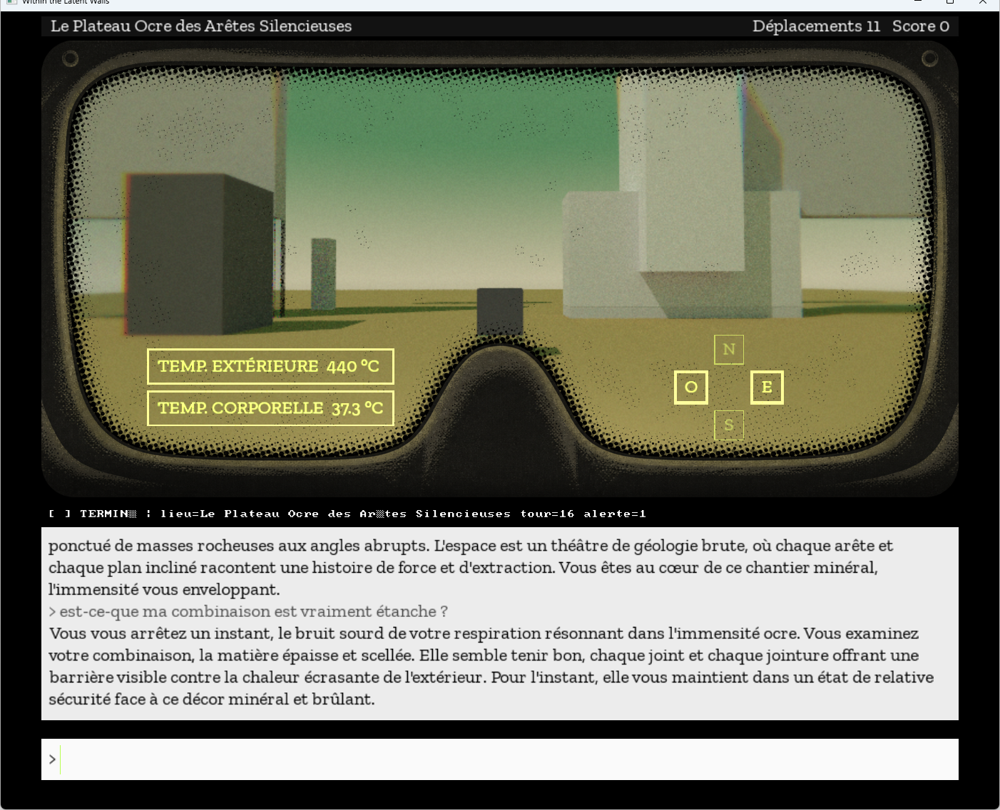

# Within the Latent Walls / Entre les Murs Latents



Fiction interactive et recherche-création : un labyrinthe vénusien inspiré de
*In the Walls of Eryx*, avec narration générée et décors calculés par un raytracer.
Le moteur C++17 garde l'autorité sur les déplacements, l'inventaire et les températures.

## Jouer

Lancer `play_within_the_latent_walls.bat` dans le dépôt, ou
`WithinTheLatentWalls.exe` dans le dossier portable. Choisir une des six langues,
puis jouer directement. Au seuil, **nord, est et sud** ouvrent l'exploration ; suivre ensuite
les issues de la boussole. `inventaire` / `inventory` / `i` consulte les possessions. `déposer la craie`,
`reprendre la craie` et `regarder tout autour` permettent de laisser et retrouver
un objet. Une petite cible décrite à l'arrivée ou révélée par une observation peut être ramassée après validation
par le moteur ; les objets et leurs retraits persistent pendant la partie.
Les formulations libres sont interprétées par le LLM ; le moteur vérifie puis exécute
la proposition. Les raccourcis exacts d'inventaire et de boussole restent directs.
Consulter l'inventaire conserve la vue et l'animation déjà calculées.

Une [enquête à indices](documentation/ENQUETE_INDICES.md) relie la disparition de
Vey, les obstructions invisibles et les cristaux. Examiner les traces, prélever
un spécimen puis demander « faire le point » alimente un carnet de constats et
d'hypothèses. Les découvertes persistent ; déposer le cristal conserve sa trace.
Le LLM choisit la [répartition des indices](documentation/REPARTITION_INDICES_LLM.md)
à la création de chaque lieu, y compris aucun indice ou plusieurs ensemble.
Ces choix restent figés lors des retours.
Après un premier contact, une [paroi transparente](documentation/PAROIS_REPEREES.md)
matérialise l'obstruction dans la vue, du côté de l'approche. La direction
correspondante devient ambrée et barrée sur la boussole. Le repère persiste
lorsqu'on revient dans le lieu ; il n'apparaît pas avant la découverte.

Quatre boucles d'ambiance OGG accompagnent le parcours. Le modèle propose leurs
niveaux dans l'appel narratif ; le moteur les valide et effectue une transition
continue de cinq secondes. Le seuil initial possède un mix pré-scripté, audible
dès le premier écran par cette même montée progressive, sans attendre une commande.
Voir le [guide audio et le diagnostic de mixage](documentation/AUDIO_AMBIENCE.md).

Gemma 4 E4B Q4_K_M tourne dans le processus via un **moteur d'inférence dédié**
à ce modèle (`engine/`) : Vulkan sous Windows et Linux, MLX/Metal sous macOS.
Il exécute directement les blocs Q4_K/Q6_K du GGUF. Aucun
service, serveur, compte ou accès Internet n'est nécessaire pour jouer après installation.
L'installeur télécharge le modèle en dernière phase, puis le jeu fonctionne hors ligne.
Le modèle est vérifié au premier appel et reste chargé jusqu'à la fermeture.
Chaque requête possède son contexte propre ; la température d'échantillonnage
suit l'évolution thermique du scaphandre.

Un seul lieu est prédéfini. Les autres sont inventés pendant la partie et gardent
leur géométrie lors des retours. Chaque lancement recommence une exploration.
Le moteur conserve une issue vers l'inconnu : les impasses restent possibles tant
qu'un autre chemin inexploré est accessible. Pour les autres pièces, il tire une
cible de deux ou trois sorties, retour compris, avec une probabilité de 50 % pour
chacune. Le LLM choisit les directions ; le moteur ajuste leur nombre si nécessaire,
dans les limites du décor existant, sans modifier la géométrie 3D.
Le modèle compose librement à partir du lieu quitté et des événements validés.
Tous les lieux restent en mémoire pendant la partie ; seul l'extrait d'historique
envoyé au modèle est réduit selon son budget de tokens.
Descriptions, `.scene`, images et résultats sont archivés sous
`%LOCALAPPDATA%/WithinTheLatentWalls/research/`, sans réutilisation au lancement suivant.

## Construire

Windows : C++17, CMake, Ninja, MSVC (VS 2022 ou plus récent), Python pour les outils,
[Vulkan SDK](https://vulkan.lunarg.com) pour les en-têtes et `glslc` du moteur LLM.
SDL3/SDL_ttf sont liés statiquement ; xgrammar (`1c9556dd`) est récupéré par CMake.

macOS (Apple Silicon) : CMake, libomp de Homebrew ; MLX (`v0.32.0`) est récupéré
par CMake et la cible de déploiement est fixée à macOS 26.2.

```powershell
python scripts/build_native.py --publish
# Préparation développeur seulement, si le GGUF manque :
python scripts/download_gemma.py
python scripts/download_gemma.py --verify-only
```

Le manifeste unique est `scripts/models.json`. Les modèles ne sont pas suivis dans Git.
Le dossier de build par défaut est `build_native/` ; le lanceur utilise le binaire
publié dans `build/Release/`. `liminal_engine_cli` (parité, rejeu d'appels capturés,
mesures) est construit avec le jeu.

## Distribution Windows

```powershell
python scripts/build_installer.py --skip-build --version 3.0.1
```

L'installeur unique et l'archive des sources sont dans `output/installer/dist/`.
Le Setup contient le jeu, ses ressources et ses DLL, sans modèle ni volumes `.bin` ;
le `vulkan-1.dll` vient du pilote graphique du joueur.
Après leur copie, il télécharge les 5,34 Go de Gemma dans le dossier du jeu et
vérifie son SHA-256. Un modèle déjà présent et valide est conservé. Aucune
installation de Python, de Vulkan SDK ou d'un service d'inférence chez le joueur.
La fabrication standard n'exige pas de GGUF local et `--skip-build` réutilise le
binaire publié sans recompiler.

Pour préparer explicitement un dossier portable complet hors ligne, utiliser
`python scripts/build_installer.py --skip-build --portable-only` avec le GGUF local
vérifié. Cette option remplace `output/installer/stage/` et ne produit pas de Setup.
Voir le [guide de distribution](documentation/WINDOWS_DISTRIBUTION.md).

## Vérifications et documentation

```powershell
ctest --test-dir build_native -C Release --output-on-failure
python -m unittest discover -s scripts -p "test_*.py"
python -m unittest discover -s tests -p "test_*.py"
python scripts/verify_native_llm.py --exe build/Release/liminal_cornell_renderer.exe --out C:/preuves/nouvelle-recette
```

`--help` expose les diagnostics : rendu, génération de scène, sessions headless,
annulation et sondes du modèle. `--llm-backend cpu-ref` (ou `LIMINAL_LLM_BACKEND`)
force l'oracle CPU, très lent, pour une recette ; `mlx` et `vulkan` forcent un device.
Le jeu normal n'affiche aucun sélecteur de backend ou de mode de scène.

- [État technique](documentation/TECHNICAL_STATE.md)
- [Prendre, déposer et retrouver les objets](documentation/INTERACTIONS_ENVIRONNEMENT.md)
- [Continuité des scènes et recette](documentation/CONTINUITE_SCENES.md)
- [Correction des faces coplanaires avant le verre](documentation/CORRECTION_COPLANAIRE.md)
- [Soutiens de verre : pilote, comparaisons et limites](documentation/SOUTIENS_VERRE.md)
- [Guide de partie et archives](documentation/SINGLE_START_RESEARCH.md)
- [Bilan du runtime autonome](documentation/BILAN_RUNTIME_AUTONOME.md)
- [Index documentaire](documentation/README.md)
