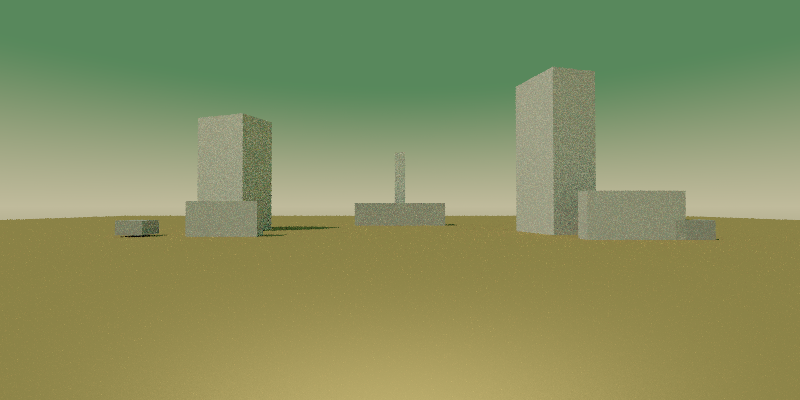
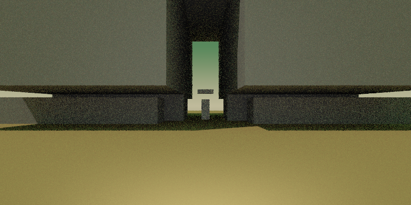

# Premier livrable — fiction et fiabilité des scènes

25 octobre 2026. Implémentation de la [spécification](SPEC_VISIBILITE_ET_FICTION.md) et première tranche du [diagnostic](DIAGNOSTIC_FICTION_ET_FIABILITE_SCENES.md).

## Jouer

Lancer **`play_within_the_latent_walls.bat`**. L'exécutable de développement est publié dans `build/Release/liminal_cornell_renderer.exe`. Ollama local avec `gemma4:e4b` reste le moteur du jeu ; DeepSeek intervient uniquement dans le développement. Aucun nouveau mode à sélectionner, aucun nouvel installeur.

Le départ reste la carrière avec sa dalle de verre. L'est découvre un lieu ; l'ouest revient au précédent. Les lieux restent identiques pendant la partie. Chaque lancement commence une nouvelle exploration : aucune archive n'est réinjectée.

Commandes à essayer : `regarder la carrière`, `regarder entre la fente`, `écouter`, `attendre`, `comparer`, `prendre le bloc`, `noter la forme des masses`, `mesurer la température`, `lire le carnet`. Les prises et transformations physiques non implémentées restent sans effet. Le carnet et les relevés existent réellement dans l'état de la partie.

## Ce qui est livré

| Lot | Comportement |
|---|---|
| A — Fiabilité locale | Normalisation conservatrice ; contrôle opaque profondeur/ID à 256 × 128 ; faux rejet du repère mince corrigé ; suppression locale bornée des obstacles dispensables. |
| B — Parole et faits | Fiche par lieu : titre, arrivée, résumé de revisite. Le contexte narratif décrit la géométrie visible mesurée, sans identifiants techniques. Les observations libres ne sont plus écrasées par un refus générique. |
| C — Continuité | Revisites françaises, historique des intentions, carnet et refus situés. Les sorties et changements d'état restent décidés par le moteur. |
| D — Reprise | Au plus trois compositions locales : initiale, correction, recomposition avec nouvelle graine. Budget partagé de 120 secondes. Pas de reprise d'une panne backend ou d'une annulation. |
| E — Interactions bornées | Notes subjectives dans le carnet, consultation et mémorisation des températures existantes. Restitution déterministe des notes et relevés pour éviter d'en inventer le contenu. |

La narration a son propre appel, plafonné à 30 secondes ; une panne conserve le décor validé et utilise un texte de secours. Une géométrie acceptée n'est jamais recomposée à cause d'un échec littéraire. La température narrative initiale est 0,65 ; la composition conserve 0,2. Le contrôleur thermique antérieur est désormais plafonné à 15 secondes et respecte l'annulation. Ces budgets sont distincts : 120 secondes n'est pas une promesse de durée totale d'un tour.

La mémoire donnée au narrateur est bornée : douze rencontres récentes ou pertinentes et seize notes récentes. L'historique complet reste dans l'état et les archives. Le narrateur ne produit aucun delta de géométrie, d'inventaire ou de ressources dans ce circuit.

## Syntaxe et visibilité

Le normaliseur traite un BOM initial, les fins de ligne, une enveloppe Markdown complète, un terminateur simple et une virgule finale dans une liste numérique complète. Il ne complète pas une coordonnée et ne supprime pas une ligne invalide. Plusieurs BOM ou terminateurs restent refusés. L'en-tête fixe accepte des espaces, représentations numériques équivalentes et un ordre différent des propriétés, après quoi le parseur strict vérifie tout le programme. Les identifiants ASCII peuvent contenir des majuscules, sans changement de leur casse ni de leur identité.

La passe de visibilité utilise **32 768 rayons**, sans éclairage ni raffinement. Les ID 16 bits correspondent aux directives : un prefab reste un seul objet malgré ses matériaux. Le verre laisse passer les rayons de cette passe, mais reste un solide pour le contrôle de caméra. La caméra dans un mur, un retour occupé et les dimensions invalides restent rejetés.

L'occultation du repère compare deux profondeurs sur cette même grille : scène opaque complète et repère seul. Au moins huit pixels projetés et plus de 95 % cachés sont nécessaires pour conclure à une occultation. Un petit repère absent de la grille n'entraîne pas à lui seul un rejet. L'obstruction proche conserve le seuil de 90 % de l'image à moins de trois mètres.

La réparation native supprime au plus deux boîtes, uniquement si le diagnostic est une occultation et si les protections permettent cette suppression. Sol, repère et supports restent protégés ; les scènes avec rotations ne passent pas cette réparation conservatrice. Chaque suppression est réauditée ; un essai non concluant est abandonné. Il reste au moins huit boîtes, conformément au contrat local.

## Recette observée

- Build Release publié ; **six cibles CTest réussies**, dont les nouveaux tests de normalisation et les sept cas de visibilité ; **72 tests Python réussis**.
- Cas original de la partie du matin : accepté sans changer les coordonnées. Repère : **104 pixels projetés, 40 occultés, 64 visibles** ; auparavant 0 impact sur la grille 64 × 32 et rejet.
- Tests déterministes : vraie occultation opaque rejetée ; verre traversé ; caméra enfermée et retour bloqué rejetés ; regroupement des matériaux d'un prefab ; suppression locale en un seul appel de composition ; support protégé ; troisième appel avec nouvelle graine et sans recopier le candidat fautif ; limite de deux appels respectée lorsqu'elle est demandée.
- Parcours réel français, graine 3719 : **neuf commandes, deux lieux, trois déplacements, deux notes**, avec observations, manipulation refusée, relevé et retour. Deux titres et deux arrivées distincts. Le retour utilise la scène mise en cache dans la partie. Aucun objet ajouté par la tentative de prise.
- Les séances intermédiaires ont révélé des numéros de volumes, des arrivées répétées et des inventions de carnet. Le contexte visuel et les contrôles ont été corrigés ; les versions intermédiaires restent dans les preuves privées, pas dans le lancement normal.

### Comparaison des reprises

Le script `scripts/qualify_scene_retry.py` compare deux et trois appels sur quatre graines historiques, avec candidats et empreintes conservés. Il exige un dossier de sortie neuf hors dépôt. La campagne finale donne **4/4 succès dans chaque configuration, soit 8/8 essais dès le premier appel**, entre **3,89 et 4,37 secondes** de composition (médiane 3,96 s). Les premières réponses des quatre paires ont des empreintes identiques dans cette campagne finale. Aucun troisième appel n'a donc été nécessaire : aucun gain marginal ne peut être déduit de ces essais. Les [mesures](diagnostics/2026-10-25-fiction/livrable-mesures.json) conservent résultats et empreinte du binaire.

La première campagne a donné 3/4 succès avec un plafond de deux appels et 4/4 avec trois, **sans aucun troisième appel effectivement utilisé dans cette dernière série**. Les premiers candidats différaient dans deux paires malgré les graines identiques. Il serait donc incorrect d'attribuer ce résultat au troisième appel. Un rejet de noms ASCII majuscules a été identifié et corrigé ensuite. Le gain marginal réel du troisième appel reste à établir ; son fonctionnement et ses limites sont vérifiés par les tests déterministes.

### Recette SDL et annulation

La partie SDL `run-20261025T143243Z-3797563584` s'est fermée normalement avec un lieu découvert, un déplacement, deux images de lieux et une narration acceptée. Les fichiers ID avant/après ont chacun l'en-tête PGM `256 128 / 65535`, **65 536 octets de pixels**, et des ID de 0 à 10 ; profondeurs exactes et table des objets sont présentes.

La partie d'annulation `run-20261025T143658Z-1232150902`, fermée pendant la génération, conserve **zéro lieu généré et zéro déplacement**. L'événement est `not_committed`, les métriques de tentative sont conservées et l'archive est close normalement. Les deux lancements utilisent des dossiers distincts. Le test de navigation natif passe également.

Le [parcours français complet](diagnostics/2026-10-25-fiction/parcours-francais-livrable.json) conserve les textes affichés, les deux fiches et les empreintes des scènes. Il permet de juger l'écriture sans se limiter à ce bilan.

## Traces de recherche

Les parties SDL restent archivées dans `%LOCALAPPDATA%/WithinTheLatentWalls/research/run-…/`. En complément des scènes, textes, images et transcriptions existants, chaque tentative contient :

- `.raw.txt`, `.normalized.scene`, `.scene` : réponse brute, programme normalisé, programme final ;
- `.json` : graine, empreintes, transformations, diagnostics avant/après, suppressions et programmes de réparation, indication de validation de la réparation ;
- `-before.ids.pgm` et `-after.ids.pgm` : bitmaps 256 × 128, ID 16 bits, 0 pour le fond ;
- `*.depth-mm.pgm` : aperçu de profondeur en millimètres, plafonné à 65 534, 65 535 pour le fond ;
- `*.depth.json` : profondeurs exactes en mètres, `null` pour l'infini, table des noms d'objets.

Un échec précoce de syntaxe ou de géométrie peut ne pas produire de bitmap. Les textes narratifs bruts, textes affichés, décisions du moteur, durées et raisons de repli sont archivés. Les annulations conservent les preuves déjà obtenues tout en abandonnant les changements d'état proposés. Les artefacts CLI de composition conservent également chaque candidat ; les bitmaps de partie sont produits par l'archive SDL.

## Limites du premier livrable

Le circuit littéraire est rétabli, mais **la qualité d'écriture n'est pas encore qualifiée comme équivalente ou supérieure à `main`**. Le modèle peut encore être répétitif, employer du vocabulaire géométrique ou ajouter une texture non établie. Les contrôles textuels ciblent certaines contradictions et fuites d'identifiants ; ils ne démontrent pas la vérité de chaque phrase. L'autorité du moteur sur l'état, elle, ne dépend pas de cette appréciation littéraire.

Il n'y a pas encore de prise d'objet, de marque physique, de scan spatial ni de transformation du décor par une commande libre. La narration s'appuie sur des proportions et une visibilité mesurées ; elle n'effectue pas une reconnaissance sémantique de l'image. Les détails plus petits qu'un pixel de la grille ne sont volontairement pas qualifiés. Le rendu final conserve ses limites artistiques antérieures, notamment le vocabulaire de boîtes et les assemblages parfois maladroits.

## Duo et preuves

DeepSeek a fourni le normaliseur et son test ([DUO-018](duo/reviews/DUO-018.md)), puis la recette de visibilité ([DUO-019](duo/reviews/DUO-019.md)). Codex a défini les interfaces, corrigé les livraisons, implémenté le runtime, la narration et les archives, puis effectué builds et recettes. Les revues consignent aussi les écarts de lecture et de procédure du CLI ; ils ne sont pas masqués par les tests réussis.

Preuves privées : `C:/works/duo-runs/game-liminal-raytraced-llm-world/fiction-validation/`, journaux de build/tests voisins. Aucun commit ni push effectué. Le passage des anciens worktrees en checkouts partiels a récupéré environ **9,8 Go**, avec comparaison des statuts Git avant/après : modifications conservées dans les 21 worktrees concernés.
