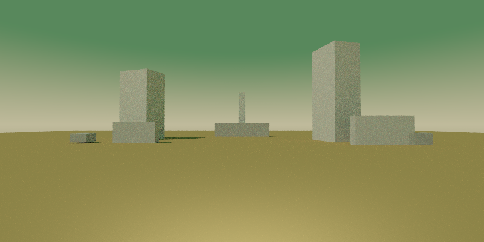

# Retrouver la fiction interactive et fiabiliser les scènes

**Suite implémentée :** [spécification](SPEC_VISIBILITE_ET_FICTION.md) et [premier livrable vérifié](BILAN_FICTION_ET_FIABILITE_SCENES.md). La décision ultérieure du joueur remplace la proposition adaptative ci-dessous par une grille fixe 256 × 128, sans raffinement. Le présent document reste le diagnostic de la version antérieure.

**Diagnostic en duo Codex + DeepSeek — 25 octobre 2026.** Recommandations uniquement : aucun changement du runtime, des prompts du jeu, des modèles ou des seuils de validation dans ce lot.

## Conclusion et décisions recommandées

Les deux problèmes signalés sont confirmés, avec des causes différentes :

1. **La narration est court-circuitée par le moteur.** À la découverte, le texte est fixé à deux phrases identiques. Pour les commandes libres dans les salles générées, le LLM peut produire une réponse, mais le moteur la remplace par un refus générique. Changer de modèle ou enrichir son prompt ne suffit donc pas.
2. **Certains rejets de scène sont des défauts du contrôle de visibilité.** Un repère mince, bien visible dans le rendu, passe entre les rayons de la grille de contrôle. Une correction supplémentaire peut consommer des secondes pour « réparer » une visibilité déjà présente.
3. **Oui à un parseur tolérant aux erreurs de syntaxe ; non à une validation géométrique permissive.** Une normalisation déterministe doit précéder toute réparation LLM. Elle ne doit jamais accepter une caméra dans un solide, changer une dimension, déplacer un objet ou transformer une sortie tronquée en scène réussie.

Recommandation : corriger le contrôle de visibilité et rétablir une narration ancrée dans les lieux ; ajouter une normalisation syntaxique explicite ; puis évaluer **un troisième appel de composition au maximum**, conditionnel et dans le délai global existant. Il s'agit d'une génération initiale et de deux tentatives supplémentaires, pas de trois retries.

## 1. Ce qui a été examiné

- Arbre de travail actuel de `ministral-reasoning`, incluant les changements indexés non commités. `HEAD` : `cf5a4d3aedbd320a2aeb4b90725d3373be7dd18c` ; ce commit seul ne représente pas le jeu actuel.
- Branche **`main` locale**, commit `ac4641e3be86affe127f5944a828808f24bf2998`, consultée avec `git show`, sans checkout ni modification de l'index. Aucun fetch ni exécution comparative de cette branche : le diagnostic de différence repose sur ses sources, pas sur une nouvelle mesure de ses performances.
- Partie réelle `run-20261025T100021Z-1112192279`, dix commandes moteur, archivée dans le dossier de recherche Windows.
- Relecture DeepSeek sur un contrat contenant les extraits actuels et les observations, dans un worktree isolé. La base du worktree étant antérieure aux modifications indexées, elle n'a pas été présentée comme le code courant. Voir la [revue DUO-017](duo/reviews/DUO-017.md).
- Reproduction Codex d'un rejet avec l'exécutable existant et deux copies diagnostiques d'une scène, hors circuit du jeu.

Les [empreintes des sources, de l'exécutable et les mesures extraites](diagnostics/2026-10-25-fiction/sources-et-mesures.json) fixent le périmètre. Les journaux complets et la livraison brute DeepSeek restent hors dépôt. Les fichiers de scène et images joints au diagnostic sont des preuves ; ils ne sont pas injectés dans une partie.

## 2. Pourquoi la génération échoue

### Les observations de cette partie

| Commande archivée | Découverte | Appels de composition | Temps de composition |
|---|---|---:|---:|
| 1 | Acceptée | 1 | 12,509 s |
| 3 | Acceptée | 1 | 6,572 s |
| 6 | Rejetée : repère invisible selon l'audit | 2 | 10,037 s |
| 7 | Même catégorie de rejet | 2 | 7,709 s |
| 8 | Acceptée | 1 | 3,959 s |
| 9 | Rejetée : repère invisible selon l'audit | 2 | 9,215 s |
| 10 | Même catégorie de rejet | 2 | 8,153 s |

Ces durées sont celles du pipeline de composition et de ses contrôles ; elles ne sont pas une mesure de toute l'attente SDL, du rendu animé ou des temps de saisie. Le premier appel inclut notamment 7,740 s de chargement Ollama.

Sur **sept demandes de découverte**, trois réussissent au premier programme et quatre échouent après leur correction. Les onze appels LLM terminent normalement : les quatre rejets ne viennent ni d'une syntaxe invalide, ni d'une troncature, ni d'un timeout. Les quatre corrections ne sauvent aucune de ces demandes selon le validateur actuel.

Ce n'est pas un taux général : les demandes sont dépendantes, avec des reprises du même brief et des graines différentes. Les commandes 6, 7 et 8 montrent qu'une troisième demande manuelle finit par réussir, après environ 25,7 secondes de composition cumulée, hors saisie. Cela justifie l'étude d'un recours automatique, sans prouver à lui seul quelle politique serait optimale. Les anciens résultats « 9/10 » portaient sur une autre recette, centrée sur la première branche ; ils ne garantissaient pas l'ensemble du parcours actuel.

### Un faux diagnostic de visibilité reproduit

Le dernier candidat de la commande 9 contient :

```text
box "portal" pos(0,3,28) size(1,8,1) rot(0,0,0) gray(0.7)
```

Le repère s'élève derrière une dalle basse. Il est visible au centre du [rendu natif diagnostique](diagnostics/2026-10-25-fiction/repere-visible-mais-rejete.png) :



Le contrôle de [scene_validation.cpp](../src/scene_validation.cpp), autour des lignes 297–337, échantillonne **64 × 32** rayons au centre des cellules et exige trois touches sur le repère. À cette distance, les deux colonnes centrales sont espacées d'environ 1,2 m dans le plan du repère, qui ne mesure qu'un mètre de large. Elles peuvent l'encadrer sans le toucher.

| Copie diagnostique | Modification | Touches de grille | Résultat natif |
|---|---|---:|---|
| [Original](diagnostics/2026-10-25-fiction/original.scene) | Aucune | 0 / 2048 | [Rejet](diagnostics/2026-10-25-fiction/original.audit.json) |
| [Variante](diagnostics/2026-10-25-fiction/decalage-060.scene) | Seulement `portal.pos.x` : 0 → 0,6 m | 4 / 2048 | [Acceptation](diagnostics/2026-10-25-fiction/decalage-060.audit.json) |

Le déplacement est une **expérience diagnostique**, pas une correction appliquée au jeu. Ce résultat établit une instabilité de l'échantillonnage et un diagnostic d'invisibilité erroné sur ce cas. Il ne prouve pas que chaque scène rejetée mérite d'être acceptée, ni que visibilité et qualité artistique sont équivalentes.

L'audit indique également que la dalle basse bloque 4 des 12 rayons dirigés vers les surfaces du repère. Une occultation partielle n'est pourtant pas une invisibilité totale. Le message pousse le LLM à déplacer des masses alors que le problème principal est ici l'alignement de la grille.

**Correction recommandée :** conserver la grille comme passe rapide, mais vérifier les cas douteux par un échantillonnage adaptatif dans la projection du repère, ou une passe d'identifiants d'objets. Chaque rayon doit toujours tester les triangles réellement visibles, avec les occultants. Distinguer les diagnostics « absent », « hors cadre », « totalement occulté », « trop petit pour être lisible » et « résolution de contrôle insuffisante ». Calibrer la lisibilité sur les rendus, sans simplement abaisser le seuil actuel.

### Ce que ferait réellement un retry de plus

Deux verrous imposent actuellement une seule correction : `scene_config.max_repairs=1` dans [turn_runner.cpp](../src/turn_runner.cpp), vers 2988, et le plafond `fixed_frame ? 1 : 2` dans [dynamic_scene.cpp](../src/dynamic_scene.cpp), vers 198. Changer le premier seul serait sans effet.

La réparation locale conserve la graine de génération, mais change le prompt en ajoutant le candidat et son diagnostic. Cela **ne prouve pas** qu'elle produit un texte identique. Les archives actuelles gardent le dernier candidat et l'historique des audits, pas tous les programmes successifs ; des nombres de tokens égaux ne suffisent pas à conclure à une copie.

Politique à tester après correction du validateur :

1. Génération initiale, normalisation syntaxique, contrôles géométriques.
2. Si un défaut réel est localisé : correction ciblée avec diagnostic précis, sous le même délai global.
3. Si le diagnostic persiste et que le budget permet un appel complet : nouvelle composition avec une graine différente et les contraintes qui ont échoué, plutôt qu'une répétition aveugle du même message.

Maximum trois appels de composition ; conserver le plafond global de 120 s comme garde-fou, sans le confondre avec une attente souhaitable. Ne pas relancer après annulation, panne persistante du backend ou délai épuisé. Compter séparément les appels narratifs futurs. Le coût marginal du troisième appel reste à mesurer : les 7,7–10 s observées ci-dessus couvrent **deux appels**, pas un appel chacun.

## 3. Le parseur tolérant : économiser les appels sans changer la scène

La proposition de l'utilisateur est pertinente. Il faut séparer trois opérations : **lire**, **normaliser**, puis **valider le sens et la géométrie**. Un parseur permissif qui ignore les lignes qu'il ne comprend pas serait dangereux : il pourrait afficher une scène amputée de son mur principal et la déclarer réussie.

| Entrée | Traitement proposé | Appel LLM ? |
|---|---|---|
| Fins de ligne Windows, espaces, BOM en début de fichier | Normalisation lexicale | Non |
| Un unique bloc Markdown entourant tout le programme | Retirer seulement cet emballage | Non ; déjà pris en charge |
| Ordre différent des propriétés nommées | Construire le même arbre de syntaxe, puis sérialiser | Non ; vérifier les cas déjà acceptés avant d'ajouter du code |
| Point-virgule final, virgule finale après une liste complète | Tolérance explicite de grammaire, si interprétation unique | Non |
| Délimiteur final manquant, mais directive complète et fin normale du modèle | À envisager seulement si la grammaire détermine une unique fermeture et toutes les valeurs sont présentes | Pas nécessairement ; tester avant activation |
| Coordonnée manquante, propriété dupliquée contradictoire, directive inconnue | Refus explicite ; ne pas deviner ni supprimer la ligne | Correction éventuelle |
| Sortie arrêtée par limite de tokens | Échec ; ne pas en sauver un sous-ensemble comme scène complète | Nouvelle génération selon budget |
| Dimension négative, valeur non finie, caméra dans un solide, retour obstrué | Rejet géométrique inchangé | Correction ciblée ou échec |

Une tolérance ne doit jamais inventer une coordonnée, prendre la valeur absolue d'une dimension, déplacer la caméra, agrandir un repère ou enlever un obstacle. Les valeurs numériques et les identifiants doivent rester inchangés entre l'entrée normalisable et sa forme canonique. Conserver dans l'archive **sortie brute, scène normalisée et liste des normalisations** ; appliquer ensuite exactement les contrôles géométriques stricts.

Le code actuel traite déjà les fins de ligne Windows, des variations d'espacement et un unique bloc Markdown complet. La première étape est donc un inventaire des erreurs syntaxiques réellement observées, pour ne pas refaire ce travail. Dans la partie examinée, un parseur plus tolérant n'aurait supprimé **aucun des quatre rejets**, tous postérieurs au parsing.

À moyen terme, le cadre fixe pourrait être fourni exclusivement par le moteur et le LLM ne produire que les objets. Cela évite de faire recopier caméra, sol et éclairage à chaque appel, sans retirer l'invention des formes. Un format d'objets structuré est une autre piste, à comparer au langage `.scene` avant migration. Il ne corrigerait pas à lui seul les mauvais placements.

## 4. Pourquoi le texte est devenu pauvre

### Une régression de circulation des réponses

Dans la voie locale, [turn_runner.cpp](../src/turn_runner.cpp), vers 3015–3032, impose le même titre et la même arrivée à toutes les découvertes :

> Un repère est visible parmi les volumes de la carrière. Le retour reste ouvert.

Cette phrase devient aussi le résumé du lieu. Les ancres et objets visibles sont vidés ; seul le token `portal` reste disponible à l'examen. Le jeu possède donc des formes différentes, mais peu de différences textuelles exploitables.

Ensuite, deux chemins retirent la parole au modèle :

- Vers 3332, `look`, `regarder` et quelques formes exactes renvoient directement ce résumé fixe.
- Vers 3464, les autres commandes dans une salle acceptée sont interprétées par le LLM, puis leur `TurnResult` est remplacé par `unsupported_scene_action` et « Rien ne change ici… », sauf si une intention de déplacement a été reroutée auparavant.

La trace réelle de **« regarder la carriere »** contient une intention `survey` et une description de la carrière. **« regarder entre la fente »** produit `inspect_portal` et une tentative de description de l'espace regardé. Les deux textes sont remplacés à l'affichage. On paie donc parfois l'inférence pour en jeter le résultat narratif.

Ces réponses brutes ne sont pas pour autant satisfaisantes : elles parlent de `'portal'`, restent assez génériques et peuvent ajouter une « distorsion » dont la géométrie ne donne pas la preuve. Les réafficher sans validation ne serait pas une solution complète.

### Ce que `main` conserve, et ses propres limites

| Aspect | `main` locale examinée | Voie locale actuelle |
|---|---|---|
| Nouvelle salle | Génération de titre, résumé et narration d'arrivée avec les métadonnées | Géométrie directe, puis titre et arrivée fixes |
| Observation | Tour narratif ordinaire | Formes exactes court-circuitées vers le résumé |
| Commande libre | Interprétation puis application des deltas sous protection canonique | Interprétation, puis écrasement dans une salle avec contrat |
| Éléments à examiner | Métadonnées de lieu et objets | Pratiquement un seul identifiant interne |
| Revisite française | Formule de déplacement ; résumé omis | Même limite héritée, aggravée par les titres identiques |

La comparaison confirme la régression fonctionnelle décrite par l'utilisateur. Elle ne démontre pas une supériorité intrinsèque de Ministral sur Gemma : les chemins de code, les prompts et les données disponibles ne sont pas équivalents.

Certaines restrictions existaient déjà dans `main` : système « deterministic interactive-fiction turn engine », instruction de rester court, concret et immédiatement jouable, plafond de 280 caractères et trois phrases pour la narration. `BuildTraversalNarrationForKnownPlace()` n'ajoute le résumé que pour l'anglais (`!localized`). Ce dernier défaut pénalise notamment le français, mais n'est pas nouveau.

Enfin, la réduction demandée à un départ unique a supprimé le parcours auteurisé, sa barrière et son retour impossible. L'exploration est désormais une chaîne est/ouest de cinq familles de briefs architecturaux. Ce choix n'impose pas une prose pauvre, mais il laisse à reconstruire les enjeux, découvertes et conséquences qui nourrissent une fiction. Il ne faut pas rétablir les six lieux supprimés pour contourner ce travail.

## 5. Restaurer une fiction, pas seulement embellir les messages

### Séparer l'état du monde, la géométrie et la narration

Le contrat à viser est : **le moteur décide ce qui arrive ; le narrateur donne à percevoir ce qui arrive**. Protéger la géométrie acceptée n'oblige pas à supprimer toute réponse à une action.

Pour les commandes sans effet physique, garder le programme `.scene` et son empreinte inchangés tout en autorisant une description, une perception ou une interprétation. Pour une manipulation, décider d'abord si un effet typé est permis, puis fournir ce résultat au narrateur. Ne pas simplement conserver une narration annonçant une prise d'objet tout en supprimant le changement d'inventaire : elle raconterait un faux événement.

Une absence d'effet peut avoir une réponse littéraire précise. Une commande ambiguë peut recevoir une clarification située. Une action impossible peut échouer de façon sensible et intelligible, sans transformer le refus en menu « observer ou choisir une direction ».

### Donner à chaque lieu une fiche narrative liée à la scène acceptée

Après validation géométrique, produire puis mémoriser pendant la partie : titre singulier, description d'arrivée, résumé de revisite, quelques éléments perceptibles nommés en français, relations spatiales, faits déjà découverts et possibilités d'action réellement disponibles. Ces éléments doivent être liés aux groupes/objets du décor et à l'état autoritatif.

Le brief décrit une intention ; il ne prouve pas que sa passerelle ou son ouverture a effectivement été réalisée. La fiche doit donc s'appuyer sur la scène acceptée, la visibilité et les faits du moteur. Une boîte nommée par le LLM ne devient pas automatiquement un objet manipulable. `portal` doit rester un identifiant interne ; son appellation visible dépend du rôle réellement validé, pas d'une traduction systématique en « portail ».

Une passe narrative après acceptation peut fournir cette fiche en une fois. Son coût doit être mesuré séparément. L'image peut être affichée dès qu'elle est prête, tandis que le texte arrive, avec un repli factuel spécifique au lieu si l'appel narratif échoue. Ne jamais régénérer une scène valide parce que sa description littéraire a échoué.

### Restaurer les intentions et la mémoire

Commencer par un lot borné : regarder un ensemble, examiner un détail, écouter, attendre, comparer avec un lieu précédent, demander un rappel ou une orientation. Les formulations libres doivent être reconnues au-delà de l'égalité exacte entre une commande et un token anglais. Les directions simples restent traitées immédiatement par le moteur.

Ajouter ensuite les manipulations adossées à des objets et des effets validés : mesurer, marquer, consulter un instrument, prendre un objet réellement disponible. Éviter de promettre ces effets dès le premier lot si leur état n'existe pas encore.

La mémoire narrative doit retenir les découvertes du joueur, les actions refusées, ce qu'il a déjà examiné et les relations entre lieux. Elle ne doit pas se limiter à remplacer un résumé par la dernière phrase affichée. Une revisite rappelle et transforme le sens d'un lieu connu ; elle ne répète pas nécessairement toute la description d'arrivée. Cette mémoire reste **intra-partie**. Les archives de recherche ne deviennent pas une mémoire du personnage dans la partie suivante.

### Une direction d'écriture à évaluer avec le joueur

La richesse recherchée tient à un point de vue, une situation, des perceptions précises, des enjeux et des conséquences. Ni l'ajout d'adjectifs, ni une température plus élevée, ni l'allongement systématique ne suffisent.

Proposition de départ à tester : arrivée de 60–100 mots lorsqu'un lieu le mérite ; observation ou action de 20–60 mots ; revisite plus brève, attentive à ce qui a déjà été appris. Ces longueurs sont des hypothèses éditoriales, pas une nouvelle règle imposée. Des budgets distincts sont préférables à une coupe uniforme à 280 caractères, qui peut tronquer une phrase ou la conséquence d'une action.

Éviter les identifiants techniques, les menus d'action répétés et les phénomènes extraordinaires ajoutés sans appui fictionnel. Préserver l'étrangeté d'Eryx par le corps, les instruments, la mémoire et les contradictions autorisées. La dalle de verre visible du départ reste distincte d'une éventuelle topologie invisible.

Un cache de description de base peut réduire le coût des revisites, mais un cache par seul couple lieu/intention ne suffit pas si l'état ou les découvertes ont changé. Il doit être conditionné par les faits pertinents de la partie. Le LLM actuel mérite d'être évalué dans ce circuit réparé avant une nouvelle migration de modèle.

## 6. Ordre de réalisation recommandé

| Lot | Périmètre | Critère de sortie |
|---|---|---|
| A — Fiabilité locale | Normalisation syntaxique explicitement bornée et validation adaptative du repère | Variantes syntaxiques équivalentes normalisées ; caméra dans un mur toujours rejetée ; cas visible joint correctement diagnostiqué |
| B — Parole et faits | Supprimer les écrasements génériques, fiche narrative d'un lieu, rendu d'une observation ancrée | Deux lieux ont des descriptions distinctes ; les deux commandes libres observées reçoivent des réponses pertinentes ; aucune mutation géométrique implicite |
| C — Déplacements et continuité | Arrivée, revisite française, mémoire des découvertes et refus contextualisés | Retour au lieu identique mais reconnu narrativement ; pas de fuite de `portal`, pas de faux déplacement ni objet gagné |
| D — Troisième tentative | Maximum trois appels de composition, diagnostics classés, stratégie de graine et budget partagés | Gain marginal mesuré face à deux appels, avec coûts et échecs conservés ; annulation immédiatement respectée |
| E — Interactions | Quelques intentions et effets typés supplémentaires | Conséquences observables, persistantes pendant la partie et décrites sans contradiction |

Les lots A et B sont prioritaires et peuvent être préparés séparément. Il n'est pas nécessaire de refondre le renderer, de changer de backend, de rétablir le parcours de sept lieux ou d'ajouter une planification complète avant eux.

## 7. Recette de comparaison et traces de recherche

**Syntaxe et géométrie.** Tester des couples brut/normalisé qui gardent exactement les mêmes valeurs, objets et triangles ; conserver des cas négatifs : coordonnées manquantes, doublons contradictoires, NaN, dimensions invalides, troncature, caméra enfermée, retour bloqué, vrai repère occulté. Pour le repère mince, faire varier légèrement sa position et la résolution afin de détecter l'aliasing, sans contourner l'occultation réelle.

**Corrections.** Rejouer un corpus fixe de briefs et graines avec deux puis trois appels, après stabilisation du validateur. Conserver séparément les erreurs de parsing, de géométrie, de prévisualisation, de backend et d'annulation. Mesurer succès initial, gain du troisième appel, latence totale et nombre d'appels. Ne pas appliquer un p95 d'un petit échantillon comme garantie générale.

**Fiction.** Comparer `main`, la version actuelle et la proposition sur des commandes d'observation, de détail, d'action possible/impossible, de déplacement et de revisite. Fixer les faits de scène et la séquence ; faire lire les textes sans annoncer leur origine. Évaluer spécificité du lieu, qualité de langue, point de vue, continuité, réponses à l'intention et absence de faux effets. Mesurer aussi texte généré contre texte affiché, durée et tokens.

Pour isoler le modèle, employer le même backend et les mêmes réglages dans un banc narratif externe lorsque les deux branches ne supportent pas le même runtime. Garder les contrats de chaque version identifiés ; imposer artificiellement le même nouveau prompt à toutes les versions masquerait une partie de la régression. Une comparaison des exécutables avec leurs configurations historiques reste utile, mais ses différences de modèle et de pipeline doivent être annoncées. Aucune de ces nouvelles campagnes A/B n'a été exécutée dans ce diagnostic.

**Archives à compléter lors de l'implémentation.** Conserver chaque candidat de composition et son empreinte, sa graine, le diagnostic reçu, la normalisation appliquée, le résultat validé, la réponse narrative brute et celle effectivement affichée, ainsi que la raison d'un remplacement. Les traces actuelles ont déjà permis de retrouver l'écrasement de deux réponses ; elles ne permettent pas de comparer intégralement tous les programmes avant/après correction. Préserver la séparation actuelle : nouvelle partie à chaque lancement, archives exclusivement destinées à la recherche.

## 8. Apport du duo et limites de la conclusion

DeepSeek confirme le diagnostic structurel de narration, recommande la séparation autorité/narration et une fiche de lieu, et demande de vérifier le sous-échantillonnage avant d'empiler les retries. Codex a ensuite établi le cas de visibilité par rendu et audit contrôlé.

La synthèse corrige trois propositions trop fortes de la livraison : la graine identique ne prouve pas une réparation neutralisée ; le coût observé de 8–10 s n'est pas celui d'un appel isolé ; conserver toute narration en neutralisant ses deltas peut raconter des effets qui n'ont pas eu lieu. L'idée de rendre toutes les boîtes examinables est également bornée par les éléments réellement perceptibles et les rôles fictionnels validés.

Le diagnostic ne conclut ni que Gemma suffit déjà à la qualité littéraire souhaitée, ni qu'un retry supplémentaire résoudra tous les échecs. Il identifie d'abord les mécanismes qui empêchent aujourd'hui de juger correctement ces deux questions.
