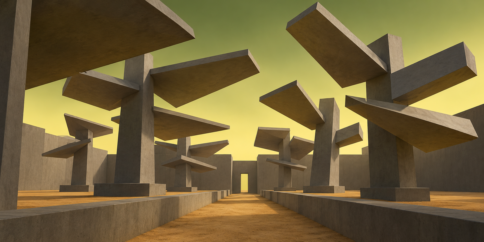
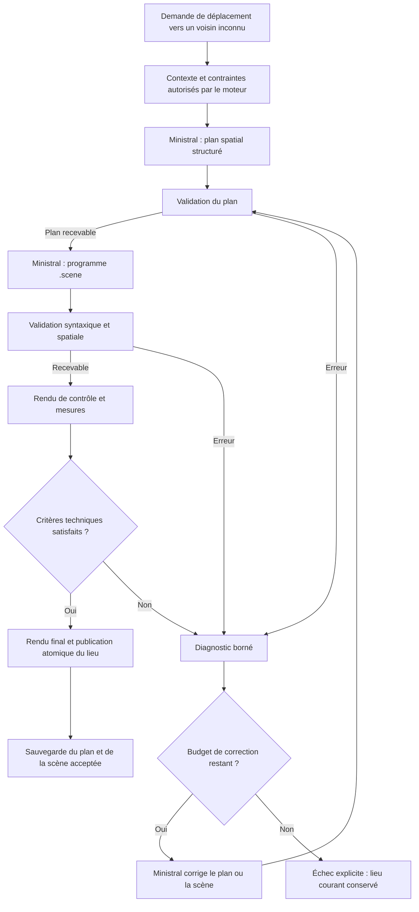

# Génération dynamique de décors par Ministral — conception et plan d’attaque

Date : **2026-10-24**. Projet : *Within the Latent Walls / Entre les Murs Latents*.

**Statut : proposition d’architecture et plan d’implémentation.** Ce document ne décrit pas une fonctionnalité déjà intégrée. Aucun nouveau pipeline d’inférence, entraînement, benchmark de scène ou changement du renderer n’a été exécuté pour ce lot documentaire. Constat technique établi sur le code du commit `bd4306f4131fbf56784ac630a122f989a7298912`.

## 1. Objectif et règle de création

Lors de la découverte d’un lieu, **Ministral imagine un décor inédit, en compose les volumes, écrit un programme dans notre langage `.scene`, puis le raytracer calcule l’image**. Le moteur vérifie la proposition et conserve l’autorité sur les faits de la partie et la navigation.

Les concept arts constituent un objectif de composition, d’ambiance et de lumière. Le système ne doit ni choisir un niveau dans une bibliothèque préfabriquée, ni récupérer une scène reproduisant une image, ni remplacer discrètement la proposition du modèle par une recette d’archétype.

La géométrie est créée pendant la partie. Une fois acceptée, elle est sauvegardée et réutilisée lors des revisites : cette persistance conserve l’identité d’un lieu effectivement découvert. Elle ne constitue pas une prégénération du monde.

La première version vise les voisins inconnus accessibles depuis les cinq branches ouvertes de la route Eryx. Les sept lieux canoniques restent des points de référence et de non-régression ; leur remplacement éventuel relève d’une étape ultérieure.

### Résultat recherché


*Référence 01 : l’intérêt vient de la relation entre les masses, le vide et le parcours. La scène ne se résume pas à une liste de portes, de caisses et de balises.*



*Référence 08 : la rotation et l’assemblage de boîtes permettent une famille de formes nouvelle, sans ajouter de végétation organique ou de maillage complexe.*


*Référence 09 : une variation d’éclairage et d’échelle peut produire une autre situation sensible avec un vocabulaire géométrique réduit.*

Les **dix images**, leurs principes transférables et leurs limites sont réunis dans l’[atlas de composition](./concept-art/ATLAS_COMPOSITION.md). Les PNG font 1774 × 887, au ratio 2:1. Ce sont des images produites avec `image_gen`, **pas des rendus certifiés du moteur**. Les textures, certains détails, halos et effets de lumière devront être simplifiés ou calibrés.

**Complément expérimental ultérieur :** les [reconstructions 01, 02, 03 et 09](./concept-art/raytracer-study/README.md) fournissent désormais des scènes manuelles et des rendus de comparaison. Elles confirment la faisabilité des grandes formes, montrent les écarts de cadrage et de matière, et ont conduit à l’ajout de `distant_light` à la demande de l’utilisateur. Ce sont des références de calibration du banc, pas des niveaux prégénérés pour le runtime.

## 2. Ce qui fonctionne aujourd’hui, et ce qui bloque la cible

| Constat dans le dépôt | Conséquence |
|---|---|
| `BuildGeneratedRoomPrompt()` demande un titre, des objets, un archétype parmi huit et 1 à 4 contraintes qualitatives « never coordinates ». | Le modèle ne dessine pas la géométrie des nouveaux lieux. |
| `BuildGeneratedRoomSceneProgram()` appelle `BuildSceneTextFromSpatialState()`, puis un secours procédural si nécessaire. | Le chemin normal fabrique une composition hybride C++ à partir des métadonnées. |
| `RefreshGeneratedRoomCache()` repasse par ce constructeur lors d’un tour dans une salle générée. | Une scène libre serait écrasée si ce chemin restait inchangé. |
| Une génération directe de `.scene` existe dans le banc et dans le chemin de scène candidate ; ce dernier exclut les lieux générés. | Une base est disponible, mais activer `prefer_candidate_scene` ne réalise pas la cible. |
| `AuditSceneCandidateText()` délègue au chargeur `LoadSceneFromSceneText()`. | Un chargement réussi n’est pas une preuve de composition, de visibilité ou de traversabilité. |
| `LlmPromptMessage` transporte un rôle et un contenu texte. | Les PNG du dossier ne sont pas transmis au modèle comme entrée visuelle. |
| Le renderer utilise les rebonds diffus, les surfaces émissives, le spot caméra et le ciel sur les rayons sans intersection. | Les fondations d’éclairage existent ; la proximité artistique reste à mesurer. |

Sources locales : [prompts](../src/turn_contract.cpp), [orchestration](../src/turn_runner.cpp), [compilation et audit](../src/scene_compiler.cpp), [interface LLM](../src/llm_runtime.h), [renderer](../src/renderer.cpp), [état technique](./TECHNICAL_STATE.md).

La [qualification Ministral](./MINISTRAL_QUALIFICATION_REPORT.md) a déjà relevé des images masquées, répétitives ou présentant des volumes apparemment flottants malgré des contrôles syntaxiques réussis. Elle ne démontre pas de supériorité artistique générale du profil Reasoning. Le point de départ reste **Ministral 3 8B Instruct Q4**, local, sur le matériel actuel.

Le prompt de métadonnées exige également plusieurs objets actionnables et des prefabs récurrents. Il faudra éviter que cette obligation remplisse chaque scène de la même petite collection d’équipements. Une interaction utile peut se rattacher à un repère intégré à une grande forme, avec un identifiant stable.

## 3. Une grammaire artistique, pas un catalogue de niveaux

### 3.1 Ce que le guide doit transmettre

Le futur guide de composition sera un texte compact injecté dans les appels de conception, avec des exemples de relations et de petites constructions. Il sera extrait des concepts et de leurs fiches, puis versionné et livré avec l’application. Le dossier documentaire complet ne sera pas chargé à chaque tour.

| Principe | Question posée au modèle | Manifestation possible |
|---|---|---|
| Identité | Quelle relation rend ce lieu reconnaissable ? | Un petit abri sous une dalle immense. |
| Hiérarchie | Quelle forme domine, quel élément attire ensuite ? | Une masse sombre encadre une lumière lointaine. |
| Profondeur | Que voit-on près, au milieu et au loin ? | Seuil proche, traversée, repère sur l’horizon. |
| Vide | Quel espace doit rester dégagé ? | Fente de ciel, cour vide, couloir réservé. |
| Échelle | Qu’est-ce qui permet d’évaluer la taille ? | Une caisse ou une entrée minuscule au pied d’un volume. |
| Rythme | Quelle répétition évolue au lieu de se copier ? | Espacements, hauteurs et angles légèrement différents. |
| Lumière | Comment les ouvertures éclairent-elles les faces ? | Ciel diffus, rebond ocre sous un porte-à-faux. |
| Parcours | Que suggère l’image, et qu’autorise réellement le jeu ? | Destination visible, détour local, barrière invisible gérée dans l’état. |

Le modèle reste libre de combiner ces principes et d’en inventer de nouvelles manifestations. Aucun champ obligatoire du type `concept_id = 01..10`, aucune liste fermée des dix silhouettes, aucune sélection automatique d’un `.scene` d’auteur.

Les exemples de syntaxe seront courts : deux appuis et une dalle, un escalier de quelques marches, une lame tournée, une ouverture obtenue entre trois boîtes. Ils enseignent une construction ; ils ne fournissent pas un lieu complet à recopier.

### 3.2 Relation avec la nouvelle

Les motifs de la [nouvelle](./IN_THE_WALLS_OF_ERYX.md) peuvent guider la conception : attrait du cristal, repères équivoques, épuisement, proximité sans accès, sortie manquée. Le contexte sélectionne quelques motifs utiles au lieu courant, sans injecter tout le récit.

Les constructions humaines visibles peuvent être opaques et monumentales. Les parois du labyrinthe invisible restent **sans contours, reflet, réfraction, grille lumineuse ou ombre révélatrice**. Leur effet appartient aux observations et aux règles de navigation.

Le récit ne prouve pas une mutation effective de son labyrinthe ; les mutations topologiques du jeu sont une transposition distincte. Ce chantier de décor dynamique n’implémente pas à lui seul leur protocole.

L’[étude d’adaptation littéraire du modèle](./ETUDE_ADAPTATION_LLM_IN_THE_WALLS_OF_ERYX.md) reste complémentaire. Aucun LoRA ni entraînement sur les dix images n’est un prérequis de ce plan. Un corpus futur devra contenir des scènes et rendus réellement vérifiés.

## 4. Pipeline cible lors de la première visite



Lors d’une correction limitée au programme, le plan déjà accepté est conservé et le contrôle reprend à la scène. Si les masses ou les passages changent, le plan repasse lui aussi par sa validation. La boucle partage **un budget global**, sans compteur réinitialisé à chaque étape.

### 4.1 Préparer un contexte compact

Le moteur fournit le lieu d’origine, la direction d’arrivée, les continuités nécessaires, l’état de la partie utile, les sorties autorisées, les barrières connues et quelques caractéristiques des lieux récemment visités. Ces dernières servent à éviter une répétition mécanique des silhouettes.

Le modèle ne reçoit aucun droit d’écrire des fichiers, de lancer une commande ou de modifier l’état global. Sa seule sortie est une proposition de données et de géométrie.

La V1 réutilise le processus autoritatif existant pour les propositions de sorties : une nouvelle sortie doit être validée avant d’être transmise comme contrainte à l’auteur de scène. La génération géométrique ne décide ensuite ni d’un lien de salle ni d’un déplacement accompli.

### 4.2 Première passe : concevoir

Ministral produit un **plan spatial court et explicite**, exploitable par le moteur et par la seconde passe. Ce plan est un livrable de conception ; il ne dépend pas de l’exposition d’un raisonnement interne.

Nom de travail : `SceneDesignV1`. Ce type n’existe pas encore.

| Champ proposé | Contenu | Autorité |
|---|---|---|
| `design_version` | Version du contrat | Moteur |
| `intent` | Identité sensible du lieu, en une ou deux phrases | Proposition LLM |
| `bounds` | Enveloppe locale bornée | LLM, contrôlée |
| `camera` | Position, cible, verticale, champ vertical | LLM, contrôlée |
| `masses` | Identifiant, rôle, centre, dimensions, rotation, relations d’appui | LLM, contrôlées |
| `focal_object_id` | Repère dominant que la caméra doit montrer | LLM, contrôlé |
| `interaction_bindings` | Correspondance des objets jouables avec les groupes de géométrie | LLM, validée par le moteur |
| `reserved_passages` | Volumes libres et points de sortie correspondant au contrat de navigation | Contraintes moteur, implantation proposée par le LLM |
| `lighting_intent` | Ouvertures au ciel, surfaces émissives, contraste souhaité | LLM dans les limites du renderer |
| `continuity` | Repères conservés depuis le lieu précédent | Moteur et propositions vérifiées |

Le schéma JSON contraint garantit les types et la forme de la réponse, pas sa vérité spatiale. Prévoir des identifiants uniques, des limites numériques et un rapport d’erreurs séparé.

Les enveloppes de masses représentent la composition générale ; elles ne remplacent pas le programme final. L’auteur de scène peut développer un assemblage en plusieurs boîtes, à condition de respecter les espaces libres, les identifiants et les relations acceptés.

### 4.3 Deuxième passe : écrire le programme

Ministral reçoit le plan validé, la référence minimale de `.scene` et les limites de la tâche. Sa réponse finale contient exclusivement un programme complet, une directive par ligne. Ne pas enfermer tout le `.scene` dans une chaîne JSON multiligne du tour narratif.

Le modèle choisit réellement la géométrie, les positions, tailles et rotations. Le moteur parse et contrôle ; il ne ramène pas la proposition à une coque d’archétype.

La convention doit être explicite et vérifiée contre [scene.cpp](../src/scene.cpp) et [renderer.cpp](../src/renderer.cpp) :

- unités locales convenues en mètres, `y` vertical ; relation entre axes locaux et directions cardinales fournie par le moteur ;
- `box pos(...)` désigne le centre, `size(...)` les dimensions complètes ;
- `rot(x,y,z)` utilise des degrés Euler ; le code applique les rotations X, puis Y, puis Z ;
- `plane` est un rectangle fini, avec une normale et deux dimensions ;
- `camera fov(...)` est un **champ vertical**, pas horizontal ; tenir compte du ratio 2:1 ;
- palette sémantique verrouillée, `gray` et `emit` disponibles, pas de `color`, `opacity` ou matériau libre ;
- les boîtes sont rotatables, les prefabs n’ont pas de rotation externe libre dans le format actuel ;
- les prismes diélectriques passent par les prefabs cristallins existants ;
- pas de boucles, CSG, sphères, cylindres ou imports inventés.

Exemple isolé de syntaxe existante, **pas un niveau ni une sortie observée de Ministral** :

```text
box "slab_01" pos(0.0,3.6,6.0) size(8.0,0.6,4.0) rot(0.0,0.0,12.0) gray(0.32)
```

Une grammaire de décodage propre à `.scene` peut réduire les erreurs de syntaxe. La première expérience peut partir du parseur et de la réparation bornée ; la grammaire fera l’objet d’une mesure séparée. Ne pas réutiliser la grammaire JSON pour cette sortie.

### 4.4 Validation, correction et publication

Le validateur retourne un rapport structuré : code d’erreur, identifiant concerné, valeur observée et contrainte attendue. Exemples de diagnostics prévus : `camera_inside_mass`, `focal_object_occluded`, `reserved_passage_blocked`, `expanded_geometry_budget_exceeded`.

La correction demande un programme complet remplaçant le candidat précédent. Le modèle ne reçoit pas la possibilité d’affaiblir le validateur ou de modifier les sorties autorisées.

La scène, ses objets jouables, son lien de retour et la narration d’arrivée ne sont publiés qu’après succès. En cas d’échec ou d’annulation, ne pas annoncer une arrivée réussie : conserver le lieu, les liens et l’état validés avant la tentative. La V1 ne facture pas le déplacement qui n’a pas été publié ; les changements d’état propres à une éventuelle mécanique d’attente devront relever d’une décision distincte.

## 5. Contrôles nécessaires et limites de leur portée

| Niveau | Contrôles à ajouter ou réutiliser | Limite à préserver |
|---|---|---|
| Protocole | Réponse finale complète, EOS, budget, délai, annulation ; version du plan | Une sortie tronquée n’est pas une scène utilisable. |
| Syntaxe | Directives admises, propriétés et arités exactes, identifiants uniques, valeurs finies, tailles positives | Le chargeur actuel ne doit pas être présenté comme un validateur complet. |
| Coût | Taille du texte, nombre de directives, triangles et matériaux après expansion des prefabs, allocations estimées | Un seul prefab peut coûter plus qu’une seule boîte. |
| Caméra | Base non dégénérée, position hors des solides, distances proches acceptables, point focal visible | Une visée valide peut encore produire une image médiocre. |
| Structure | Contacts attendus, sol de référence, appuis des masses signalées comme soutenues | Pas de solveur physique général ; intersections constructives autorisées. |
| Passage | Volumes réservés dégagés, points d’entrée/sortie cohérents, contrôle local du sol et des marches si nécessaire | Un segment libre ne prouve pas un parcours complet. |
| Sémantique | Objets interactifs reliés à la géométrie acceptée, narration compatible, barrières invisibles absentes du rendu | L’image ne décide pas de la topologie du monde. |
| Image | Étendue visible du repère, taux de masquage proche, luminance et contraste ; mesures contextualisées par le plan | Un ciel vide ou une scène nocturne ne doivent pas être rejetés par un score universel. |

Conserver une représentation légère des primitives et des identifiants de groupes pour les contrôles. Une simple AABB englobante donne trop de faux positifs sur une boîte tournée ou un portique creux. Utiliser les transformations et/ou les triangles des objets pertinents ; ne pas interdire tout chevauchement.

Les diagnostics de couverture peuvent nécessiter une passe profondeur/identifiants ou des rayons de sondage. Ces sorties sont à développer : elles ne sont pas promises par la seule fonction RGB actuelle.

La navigation du jeu est aujourd’hui un graphe de lieux. La V1 doit vérifier les raccords et les passages déclarés dans la vue, **sans prétendre fournir une navigation 3D continue**. Une vérification complète de marche, de marches d’escalier et de volumes de collision serait un chantier supplémentaire.

## 6. Rendu, budgets et qualité artistique

### 6.1 Ce qui doit être calibré

Comparer à scène identique : ciel, contribution du spot caméra, exposition, rebonds, échantillons par pixel, matériaux et post-process. Le ciel contribue déjà aux chemins diffus lorsqu’ils s’échappent de la géométrie. Le code n’en fait pas pour autant une garantie de rendu identique aux images générées.

Faire d’abord les comparaisons sur des PNG sans visière, HUD ou flou périphérique, puis vérifier l’image dans la vue SDL complète. Un repère bien placé dans le PNG peut disparaître derrière l’encoche de visière ou perdre sa lisibilité en périphérie.

Des petites scènes de calibration faites à la main peuvent servir de tests du renderer. Elles ne doivent jamais devenir des lieux servis au joueur par le nouveau mode dynamique.

### 6.2 Budgets d’expérience, à mesurer avant adoption

| Paramètre | Hypothèse de départ pour le banc | Condition avant intégration |
|---|---|---|
| Complexité | 20 à 60 boîtes/plans, quelques prefabs ; plafond provisoire de 96 directives géométriques | Fixer aussi un plafond d’expansion triangles/matériaux et de mémoire. |
| Plan | Jusqu’à 1 024 tokens finaux | Vérifier la complétude avec le vrai tokenizer et des plans de taille variable. |
| Programme | Comparer 2 048 et 4 096 tokens finaux | Mesurer les longueurs réelles ; ne pas tronquer pour respecter le plafond. |
| Contexte | Taille minimale contenant prompt + sortie réservée + marge du template | Mesurer RAM/VRAM sur RTX 4060 8 Go ; ne pas supposer qu’un grand contexte est gratuit. |
| Aperçu | 256 × 128, 4 à 8 spp | Tester le bruit des mesures et le coût avant de fixer les seuils. |
| Corrections | Deux appels correctifs maximum au total, plan et programme confondus | Conserver un délai global, incluant les chargements et tous les appels. |
| Réflexion | Instruct sans profil Reasoning comme référence | Comparaison séparée uniquement si un gain est observé. |
| Final | Preset du jeu à 800 × 400 ; rendus d’étude plus grands séparés | Mesurer aussi le coût des huit vues animées. |

Ces nombres sont des **points de départ**, pas des résultats ni des réglages déjà disponibles. Les appels natifs actuels peuvent recharger le modèle ; deux passes et des réparations peuvent augmenter sensiblement le délai. Mesurer chargement, prompt, génération, audit, aperçu, premier rendu et animation séparément.

Le couplage existant entre température corporelle et échantillonnage doit être traité explicitement. Proposition : conserver son influence créative sur le plan, comparer une température bornée plus stable pour l’écriture technique et la réparation. Toute adoption de cette séparation doit être documentée et testée, sans modifier silencieusement la mécanique thermique.

### 6.3 Critère artistique

Le modèle texte ne voit pas le PNG de contrôle dans l’intégration actuelle. Il peut corriger à partir de mesures et de diagnostics, mais il ne faut pas présenter cette boucle comme une critique visuelle autonome.

La revue humaine évalue silhouette, profondeur, vide, hiérarchie, lumière et variété. Une ressemblance pixel à pixel avec le concept art n’est pas l’objectif : il faut retrouver sa qualité de composition dans **des lieux nouveaux**.

Une entrée visuelle et un critique multimodal seraient une option ultérieure, avec leur propre coût et leur propre qualification. Le système de base doit pouvoir fonctionner localement avec l’entrée texte existante.

## 7. Identité du lieu, sauvegarde et interactions

### Première découverte

Construire un candidat hors de l’état courant. Accepter ensemble métadonnées, plan, géométrie, objets jouables et liens ; publier cette version de manière atomique après les contrôles. La narration d’arrivée décrit seulement les éléments acceptés. Si elle est préparée avant la géométrie, vérifier ses références et la régénérer sobrement si elles ne correspondent plus.

### Revisite et commande ordinaire

Recharger le `.scene` accepté sans appel de composition. Un `regarder` ne reconstruit pas l’architecture. Adapter `RefreshGeneratedRoomCache()` pour reconnaître cette provenance et ne pas repasser par la recette hybride.

Un changement de météo ou de lumière n’autorise pas une nouvelle architecture. Distinguer version géométrique et paramètres de présentation. Pour la V1, privilégier des opérations étroites sur des objets identifiés plutôt qu’une réécriture globale libre à chaque action.

### Interaction qui modifie un objet

Une action validée peut proposer une mise à jour ciblée : déplacer une caisse, allumer une lampe, changer un instrument. Vérifier les objets, les droits et le coût, puis appliquer une nouvelle version atomique. Tant qu’une catégorie de mutation n’est pas supportée, la narration ne doit pas affirmer qu’elle a changé visuellement le décor.

### Données à persister

Étendre le contrat de sauvegarde sous contrôle de Codex : texte `.scene` accepté, plan, version de contrat, identifiants d’objets et associations, provenance, empreinte du programme, graine et identifiant du profil/modèle, versions des prompts, compte de corrections. Ne pas y stocker de chaînes de raisonnement privées ou de journaux bruts.

Les anciennes sauvegardes restent lisibles. Conserver leur scène existante et leur provenance historique ; ne pas régénérer rétroactivement leurs lieux. Une graine seule ne garantit pas de reconstruire une scène après un changement de modèle, de sampler ou de version : le programme accepté est la référence.

Les publications tardives après annulation ou changement de lieu sont rejetées, y compris celles du worker des vues animées.

### Échec

Après épuisement des corrections, garder la dernière vue et le lieu courant, signaler brièvement que le passage n’a pas pu être préparé et permettre une nouvelle tentative. Ne pas présenter cet échec technique comme une barrière fictionnelle nouvellement découverte.

Le mode hybride peut rester une option explicite de compatibilité ou de comparaison. Il ne sert pas de secours caché dans le mode dynamique qualifié. Le statut d’une tentative échouée reste un échec dans les mesures.

## 8. Plan d’attaque ordonné

Tous les lots ci-dessous sont **à faire**. Les noms de nouveaux fichiers et d’options sont des propositions, pas des éléments déjà présents. Les échéances seront estimées après le premier pilote ; aucun délai d’inférence n’est promis.

| Lot | Travail et livrables | Dépendances | Critère de passage |
|---|---|---|---|
| DYN-01 — Contrat | Définir `SceneDesignV1`, contexte de navigation, rapports d’erreurs, conventions géométriques, budgets et sémantique d’échec. Produire le guide artistique compact depuis l’atlas. | Présent document | Schémas relus, cas valides/invalides définis, aucun choix automatique d’un des dix concepts. |
| DYN-02 — Génération hors jeu | Banc natif utilisant le vrai runtime : plan JSON puis `.scene`, sorties et métriques séparées, annulation et EOS. Comparaison avec génération directe. | DYN-01 | Une génération complète produit un PNG réel avec provenance ; une erreur/troncature est comptée comme échec. |
| DYN-03 — Audit spatial | Garder identifiants/groupes, contrôler géométrie, caméra, passages et coût après expansion. Ajouter les diagnostics structurés. | DYN-01 ; parallélisable avec DYN-02 après contrat | Cas adverses détectés ; assemblages valides et ouvertures de prefabs ne sont pas rejetés systématiquement. |
| DYN-04 — Réparation et aperçu | Boucle de correction bornée, sondes de visibilité, aperçu, délai global. Calibrer les réglages lumineux sur le renderer existant. | DYN-02 + DYN-03 | Échecs réparables corrigés sans modifier la navigation ; échecs persistants et annulations arrêtés proprement. |
| DYN-05 — Qualification visuelle | Corpus inédit, plusieurs graines, revue des PNG, comparaison directe/deux passes/hybride. Geler des seuils et budgets praticables. | DYN-04 | Gain artistique constaté avec coûts mesurés ; pas de validation fondée sur la syntaxe seule. |
| DYN-06 — Création native de lieu | Brancher la voie acceptée dans `BuildGeneratedRoomSceneProgram()` avec mode explicite ; publication transactionnelle et narration raccordée. | DYN-05 | Les cinq branches Eryx créent de vrais nouveaux décors LLM ; aucun secours hybride silencieux. |
| DYN-07 — Persistance | Adapter `GeneratedRoom`, sérialisation, revisites, cache et mises à jour étroites. | Contrat DYN-01 ; intégration avec DYN-06 | Sauvegarde/rechargement/revisite conservent la scène ; aucune réécriture après un simple `regarder`. |
| DYN-08 — SDL et animation | Statuts sobres, annulation, première image acceptée puis animation, protection contre les publications obsolètes, contrôle sous visière. | DYN-06 + DYN-07 | Interface réactive ; aucun décor partiellement validé affiché comme lieu atteint. |
| DYN-09 — Recette et distribution | Sessions longues, régressions, mesures finales, documentation, ressources du guide dans le packaging. | DYN-08 | Critères de livraison ci-dessous satisfaits ; activation du défaut seulement après qualification. |

### Surfaces de code prévues

| Zone | Modifications prévues |
|---|---|
| [turn_contract.cpp](../src/turn_contract.cpp), [turn_contract.h](../src/turn_contract.h) | Séparer contexte, plan, programme et réparation ; compléter le langage réel ; enlever l’interdiction des coordonnées du nouveau plan. |
| [turn_runner.cpp](../src/turn_runner.cpp), [turn_runner.h](../src/turn_runner.h) | Orchestration, budget global, provenance, publication, narration et échec ; éviter la reconstruction hybride des lieux libres. |
| [game_state.h](../src/game_state.h), sérialisation dans le runner | Contrat versionné de plan, associations et identité du lieu ; compatibilité des sauvegardes. |
| [scene.cpp](../src/scene.cpp), [scene.h](../src/scene.h) | Préserver les informations nécessaires à l’audit, noms et groupes ; limiter l’expansion avant allocations excessives. |
| [scene_compiler.cpp](../src/scene_compiler.cpp) | Garder les chemins canoniques/historiques explicites ; ne pas recompiler une scène LLM acceptée par heuristique. |
| Nouveaux `scene_design.*`, `scene_validation.*` proposés | Types et vérifications isolés pour éviter de tout ajouter au runner. |
| [llm_runtime.cpp](../src/llm_runtime.cpp), [llm_runtime.h](../src/llm_runtime.h) | Budgets par tâche et métriques ; étude de réutilisation du modèle seulement si les mesures la justifient. |
| [renderer.cpp](../src/renderer.cpp), [renderer.h](../src/renderer.h) | Aperçu/sondes si nécessaire ; éventuels changements d’éclairage dans un lot distinct, comparé à scène identique. |
| [sdl_frontend.cpp](../src/sdl_frontend.cpp), [animated_view.cpp](../src/animated_view.cpp) | Phases de travail, annulation, version de scène et publication des huit images. |
| [main.cpp](../src/main.cpp), [CMakeLists.txt](../CMakeLists.txt) | Commandes de banc et mode explicite, sources et tests nouveaux. |
| [scripts](../scripts/), [packaging](../packaging/) | Corpus, rapports, distribution du guide et des contrats nécessaires au runtime. |

Options de travail possibles : `--scene-generation-mode hybrid|dynamic`, `--dump-scene-design-prompt`, `--scene-design-self-test`. **Elles n’existent pas encore et ne sont pas des commandes à lancer.** Leur interface définitive appartient à DYN-01.

## 9. Expérience comparative et recette

### 9.1 Vérifier l’hypothèse de composition en deux passes

Constituer 10 briefs nouveaux, dérivés de relations de composition plutôt que de copies des images, et 3 graines par brief. Réserver en plus 5 briefs de recombinaisons inédites qui ne servent pas à corriger les prompts. Exemple de recombinaison : une faille étroite conduisant à un champ de lames inclinées, avec repère lumineux sous le niveau du regard.

Comparer :

1. la génération directe `.scene` avec le guide artistique ;
2. la chaîne plan puis `.scene`, avec le même guide et les mêmes contraintes ;
3. la chaîne hybride existante comme référence du jeu actuel.

Garder modèle, paramètres de rendu et briefs identiques quand c’est possible ; publier les différences de prompts et de budgets. L’hybride ne dispose pas de la même liberté géométrique : sa comparaison porte sur le comportement livré, pas sur une égalité parfaite de conditions.

Mesurer la réussite initiale, la réussite après correction, le taux d’échec final, le nombre d’appels, les tokens, les délais par étape, RAM/VRAM et coût de rendu. Une correction réussie n’est pas une réussite du premier coup.

Prévoir un plafond d’essais pour le pilote afin de ne pas lancer d’emblée toute la matrice : trois briefs et deux graines suffisent à vérifier le fonctionnement, mais pas à conclure sur la qualité générale.

### 9.2 Revue des images

Montrer des planches mélangeant les méthodes, avec provenance accessible séparément. Noter de 0 à 4 : silhouette, profondeur, espace vide, point focal, lumière, cohérence jouable, diversité. Une note plus élevée signifie une meilleure satisfaction du critère. Pour la décision ci-dessous, le score de composition est la moyenne de silhouette, profondeur, espace vide et point focal ; la diversité s'évalue également sur la série entière. Décrire aussi les défauts observés ; ne pas déduire une qualité artistique d’un score technique.

Seuils de décision **proposés**, à figer avant la campagne complète : au moins 90 % de scènes acceptées dans le budget total ; aucun échec d’intégrité de l’état ; et un gain médian d’au moins un point sur la composition par rapport à l’hybride sur les cas appariés. L’évaluation visuelle ne justifie pas à elle seule une promesse de généralisation ; les cas réservés et les graines doivent confirmer la tendance.

Publier également la comparaison avec la voie directe enrichie. Si le plan séparé n’apporte pas de gain suffisant pour son coût, conserver la liberté de géométrie et revoir cette décomposition plutôt que l’imposer par principe.

### 9.3 Contrôles d’intégration indispensables

- Parsing et caméra : propriétés inconnues, valeurs non finies, doublons, plan incomplet, géométrie énorme, caméra dans une boîte tournée.
- Structure : support valide, porte-à-faux volontaire, intersection constructive, ouverture de prefab, passage réellement obstrué.
- Protocole : EOS absent, contexte insuffisant, délai dépassé, annulation pendant plan, programme, correction et rendu.
- Navigation : cinq créations de voisins, retours, sorties bloquées, barrière invisible, retour non réciproque canonique.
- État : absence de coût ou de lien fantôme après échec ; aucune narration d’arrivée avant publication.
- Persistance : sauvegarde/rechargement, revisite sans appel de composition, anciens fichiers, noms et chemins accentués.
- Présentation : SDL, six langues, HUD/visière, scène nocturne, séquence animée et rejet d’images tardives.
- Régression : sept scènes canoniques, références historiques, tests de canaux et auto-tests existants.

Les commandes existantes de construction et de non-régression restent celles du [guide runtime](./MINISTRAL_RUNTIME_GUIDE.md). Les tests nouveaux doivent vérifier les défauts précédents et le comportement observable, sans simplement répéter l’implémentation.

### 9.4 Définition de « terminé »

Le système sera considéré implémenté lorsque :

- un voisin inconnu est conçu et écrit par Ministral pendant une vraie partie ;
- le programme accepté est celui rendu et sauvegardé, sans remplacement par une recette ;
- les créations sont variées et la campagne documente leur proximité artistique avec l’atlas ;
- les contrôles et corrections respectent un budget fini, avec échecs honnêtement comptés ;
- les objets jouables, sorties et narrations restent cohérents avec la scène acceptée ;
- les revisites conservent l’identité des lieux et les anciennes sauvegardes restent exploitables ;
- la latence et la mémoire sur la machine cible sont publiées, y compris les cas défavorables ;
- l’interface permet d’attendre, d’annuler et de reprendre sans état partiel ;
- les commandes et ressources de distribution sont documentées et vérifiées.

## 10. Répartition du travail et premier démarrage

Codex conserve la conception des contrats, les interfaces, l’autorité du monde, les sauvegardes, l’orchestration, la mémoire, les builds, la revue visuelle et l’intégration finale. Les lots bornés pourront être confiés à DeepSeek via Copilot CLI/Ollama : corpus après contrat, documentation d’une interface stabilisée, cas adverses ou outil de rapport isolé.

Chaque délégation suit le [workflow local](./duo/SETUP.md) : contrat exact, nouveau worktree, parents créés, preuve extérieure au dépôt, arrêt sur échec d’outil, revue des écritures et intégration sélective. Le duo de développement ne change pas le modèle exécuté par le jeu.

Les prochaines actions concrètes seront :

1. DYN-01 : rédiger le schéma du plan, le contexte de sorties et la table des diagnostics, puis extraire le guide artistique compact.
2. DYN-02 : faire passer trois briefs inédits par le runtime natif, sans raccord SDL ni remplacement des salles actuelles.
3. DYN-03/04 : vérifier les défauts spatiaux, corriger de manière bornée et rendre les candidats sur le vrai raytracer.
4. Examiner les premiers PNG avant d’étendre la campagne ou d’intégrer le parcours de jeu.

Les contrats et revues de développement restent dans `documentation/duo/`. Les journaux, profils et preuves brutes des exécutions restent sous `C:/works/duo-runs/game-liminal-raytraced-llm-world/`. Le dépôt accueille les synthèses, le corpus approuvé et les images sélectionnées, sans secrets ni journaux bruts.

## 11. Références et suivi documentaire

- [Atlas des dix concepts](./concept-art/ATLAS_COMPOSITION.md) : images, principes et notes originales.
- [Format de scène réellement supporté](./SCENE_FORMAT_V1.md).
- [État technique](./TECHNICAL_STATE.md) et [qualification Ministral](./MINISTRAL_QUALIFICATION_REPORT.md).
- [Banc direct existant](./SCENE_MODEL_MIGRATION_BENCHMARK.md).
- [Plan hybride historique](./HYBRID_SCENE_LAYOUT_PLAN.md) : décrit la voie actuelle, pas la future composition libre.
- [Validation spatiale](./SPATIAL_VALIDATION_PLAN.md) et [pipeline fonctionnel](./FUNCTIONAL_PIPELINE_V1.md).
- [Étude d’adaptation littéraire](./ETUDE_ADAPTATION_LLM_IN_THE_WALLS_OF_ERYX.md) : chantier complémentaire d’apprentissage.
- [Progression du duo](./duo/PROGRESS.md).

À chaque lot DYN exécuté, consigner les résultats observés, les images obtenues, les coûts, les limites et la décision de passage au lot suivant. Jusqu’à cette exécution, tous les gains et budgets de ce document restent des hypothèses de travail.

