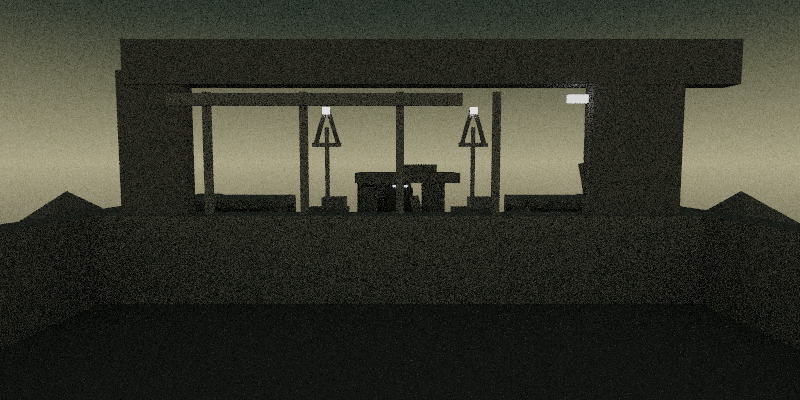
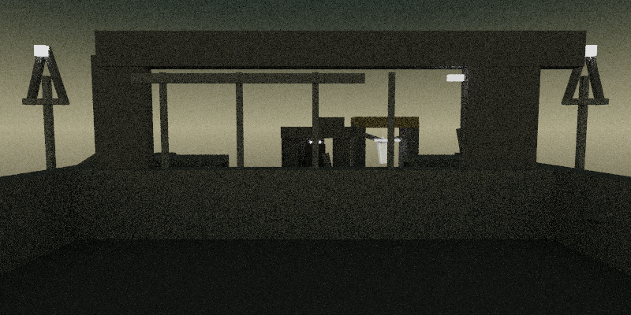
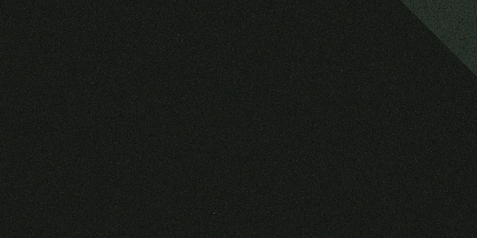

# Comparaison Ministral / Gemma — génération directe de scènes

Première exécution : 2026-10-24T09:09:32. 10 briefs identiques par variante ; détails des profils dans les preuves.

La validité syntaxique correspond à l’acceptation par le renderer. Le contrôle de caméra rejette une base dégénérée ; il ne mesure ni la composition artistique, ni la fidélité au brief.

| Variante | Syntaxe | Caméra non dégénérée et syntaxe valide | Génération médiane | p95 empirique |
|---|---:|---:|---:|---:|
| A0-ministral | 10/10 | 10/10 | 22.49 s | 26.49 s |
| A1-ministral | 10/10 | 10/10 | 22.17 s | 26.06 s |
| B-gemma | 10/10 | 2/10 | 17.01 s | 19.70 s |
| C256-gemma | 9/10 | 2/10 | 17.80 s | 21.83 s |

Le temps de génération inclut le chargement et le processus CLI, mais exclut le hachage initial, la création du prompt et le rendu. Avec dix observations, le p95 par rang correspond au maximum ; ce n’est pas une estimation sur plusieurs sessions.

Les journaux détaillés renseignent les tokens, la fin EOS, le traitement du prompt, le décodage et les allocations à la fermeture. Ces allocations ne sont pas un pic RAM/VRAM. Le premier texte utile n’est pas chronométré.

## Détail et images

### A0-ministral

Modèle : `Ministral-3-8B-Instruct-2512-Q4_K_M.gguf`. Réflexion : `legacy default`, budget `None`.

Prompts utilisateur différents de la première variante : 0.

[Résultats bruts](generated/scene_model_comparison/A0-ministral/results.json)

| Cas | Statut initial | Contrôle caméra | Génération | Image |
|---|---|---|---:|---|
| entry_gate_dusk | valid | OK | 23.41 s | [voir](generated/scene_model_comparison/A0-ministral/images/entry_gate_dusk.png) |
| sally_port_checkpoint | valid | OK | 21.28 s | [voir](generated/scene_model_comparison/A0-ministral/images/sally_port_checkpoint.png) |
| badge_vestibule | valid | OK | 19.53 s | [voir](generated/scene_model_comparison/A0-ministral/images/badge_vestibule.png) |
| server_aisles_dense | valid | OK | 22.55 s | [voir](generated/scene_model_comparison/A0-ministral/images/server_aisles_dense.png) |
| control_hub | valid | OK | 18.35 s | [voir](generated/scene_model_comparison/A0-ministral/images/control_hub.png) |
| backup_vault | valid | OK | 26.18 s | [voir](generated/scene_model_comparison/A0-ministral/images/backup_vault.png) |
| cooling_exchange_bay | valid | OK | 23.91 s | [voir](generated/scene_model_comparison/A0-ministral/images/cooling_exchange_bay.png) |
| loading_dock_dust | valid | OK | 26.49 s | [voir](generated/scene_model_comparison/A0-ministral/images/loading_dock_dust.png) |
| roof_watch_dusk | valid | OK | 22.35 s | [voir](generated/scene_model_comparison/A0-ministral/images/roof_watch_dusk.png) |
| stairhead_parapet | valid | OK | 22.44 s | [voir](generated/scene_model_comparison/A0-ministral/images/stairhead_parapet.png) |

### A1-ministral

Modèle : `Ministral-3-8B-Instruct-2512-Q4_K_M.gguf`. Réflexion : `off`, budget `0`.

Prompts utilisateur différents de la première variante : 0.

[Résultats bruts](generated/scene_model_comparison/A1-ministral/results.json)

| Cas | Statut initial | Contrôle caméra | Génération | Image |
|---|---|---|---:|---|
| entry_gate_dusk | valid | OK | 22.75 s | [voir](generated/scene_model_comparison/A1-ministral/images/entry_gate_dusk.png) |
| sally_port_checkpoint | valid | OK | 21.22 s | [voir](generated/scene_model_comparison/A1-ministral/images/sally_port_checkpoint.png) |
| badge_vestibule | valid | OK | 19.16 s | [voir](generated/scene_model_comparison/A1-ministral/images/badge_vestibule.png) |
| server_aisles_dense | valid | OK | 24.94 s | [voir](generated/scene_model_comparison/A1-ministral/images/server_aisles_dense.png) |
| control_hub | valid | OK | 18.29 s | [voir](generated/scene_model_comparison/A1-ministral/images/control_hub.png) |
| backup_vault | valid | OK | 26.06 s | [voir](generated/scene_model_comparison/A1-ministral/images/backup_vault.png) |
| cooling_exchange_bay | valid | OK | 23.27 s | [voir](generated/scene_model_comparison/A1-ministral/images/cooling_exchange_bay.png) |
| loading_dock_dust | valid | OK | 23.05 s | [voir](generated/scene_model_comparison/A1-ministral/images/loading_dock_dust.png) |
| roof_watch_dusk | valid | OK | 21.59 s | [voir](generated/scene_model_comparison/A1-ministral/images/roof_watch_dusk.png) |
| stairhead_parapet | valid | OK | 21.58 s | [voir](generated/scene_model_comparison/A1-ministral/images/stairhead_parapet.png) |

### B-gemma

Modèle : `gemma-4-E4B-it-Q4_K_M.gguf`. Réflexion : `off`, budget `0`.

Prompts utilisateur différents de la première variante : 0.

[Résultats bruts](generated/scene_model_comparison/B-gemma/results.json)

| Cas | Statut initial | Contrôle caméra | Génération | Image |
|---|---|---|---:|---|
| entry_gate_dusk | valid | camera view direction is parallel to its up vector (normalized cross product 0 <= 1e-4) | 15.04 s | [voir](generated/scene_model_comparison/B-gemma/images/entry_gate_dusk.png) |
| sally_port_checkpoint | valid | camera view direction is parallel to its up vector (normalized cross product 0 <= 1e-4) | 14.96 s | [voir](generated/scene_model_comparison/B-gemma/images/sally_port_checkpoint.png) |
| badge_vestibule | valid | camera view direction is parallel to its up vector (normalized cross product 0 <= 1e-4) | 17.51 s | [voir](generated/scene_model_comparison/B-gemma/images/badge_vestibule.png) |
| server_aisles_dense | valid | camera view direction is parallel to its up vector (normalized cross product 0 <= 1e-4) | 19.70 s | [voir](generated/scene_model_comparison/B-gemma/images/server_aisles_dense.png) |
| control_hub | valid | camera view direction is parallel to its up vector (normalized cross product 0 <= 1e-4) | 14.17 s | [voir](generated/scene_model_comparison/B-gemma/images/control_hub.png) |
| backup_vault | valid | camera view direction is parallel to its up vector (normalized cross product 0 <= 1e-4) | 17.29 s | [voir](generated/scene_model_comparison/B-gemma/images/backup_vault.png) |
| cooling_exchange_bay | valid | camera view direction is parallel to its up vector (normalized cross product 0 <= 1e-4) | 16.72 s | [voir](generated/scene_model_comparison/B-gemma/images/cooling_exchange_bay.png) |
| loading_dock_dust | valid | OK | 14.57 s | [voir](generated/scene_model_comparison/B-gemma/images/loading_dock_dust.png) |
| roof_watch_dusk | valid | OK | 18.58 s | [voir](generated/scene_model_comparison/B-gemma/images/roof_watch_dusk.png) |
| stairhead_parapet | valid | camera view direction is parallel to its up vector (normalized cross product 0 <= 1e-4) | 17.37 s | [voir](generated/scene_model_comparison/B-gemma/images/stairhead_parapet.png) |

### C256-gemma

Modèle : `gemma-4-E4B-it-Q4_K_M.gguf`. Réflexion : `on`, budget `256`.

Prompts utilisateur différents de la première variante : 0.

[Résultats bruts](generated/scene_model_comparison/C256-gemma/results.json)

| Cas | Statut initial | Contrôle caméra | Génération | Image |
|---|---|---|---:|---|
| entry_gate_dusk | valid | camera view direction is parallel to its up vector (normalized cross product 0 <= 1e-4) | 19.13 s | [voir](generated/scene_model_comparison/C256-gemma/images/entry_gate_dusk.png) |
| sally_port_checkpoint | valid | camera view direction is parallel to its up vector (normalized cross product 0 <= 1e-4) | 19.45 s | [voir](generated/scene_model_comparison/C256-gemma/images/sally_port_checkpoint.png) |
| badge_vestibule | valid | camera view direction is parallel to its up vector (normalized cross product 0 <= 1e-4) | 18.31 s | [voir](generated/scene_model_comparison/C256-gemma/images/badge_vestibule.png) |
| server_aisles_dense | valid | OK | 21.83 s | [voir](generated/scene_model_comparison/C256-gemma/images/server_aisles_dense.png) |
| control_hub | valid | camera view direction is parallel to its up vector (normalized cross product 0 <= 1e-4) | 14.02 s | [voir](generated/scene_model_comparison/C256-gemma/images/control_hub.png) |
| backup_vault | invalid_scene | camera view direction is parallel to its up vector (normalized cross product 0 <= 1e-4) | 17.29 s | — |
| cooling_exchange_bay | valid | camera view direction is parallel to its up vector (normalized cross product 0 <= 1e-4) | 16.51 s | [voir](generated/scene_model_comparison/C256-gemma/images/cooling_exchange_bay.png) |
| loading_dock_dust | valid | camera view direction is parallel to its up vector (normalized cross product 0 <= 1e-4) | 19.46 s | [voir](generated/scene_model_comparison/C256-gemma/images/loading_dock_dust.png) |
| roof_watch_dusk | valid | OK | 15.87 s | [voir](generated/scene_model_comparison/C256-gemma/images/roof_watch_dusk.png) |
| stairhead_parapet | valid | camera view direction is parallel to its up vector (normalized cross product 0 <= 1e-4) | 15.17 s | [voir](generated/scene_model_comparison/C256-gemma/images/stairhead_parapet.png) |

## Premier cas : comparaison visuelle

### A0-ministral

### A1-ministral

### B-gemma

### C256-gemma

