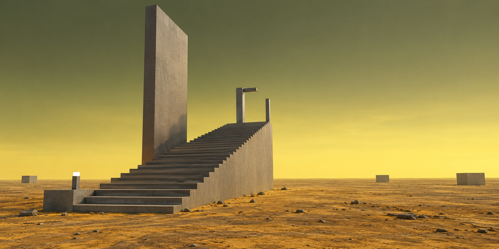
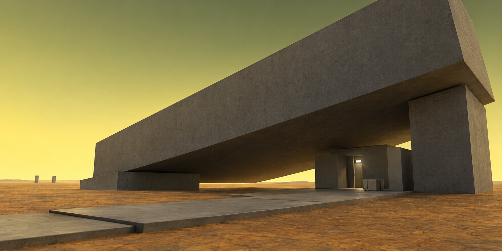
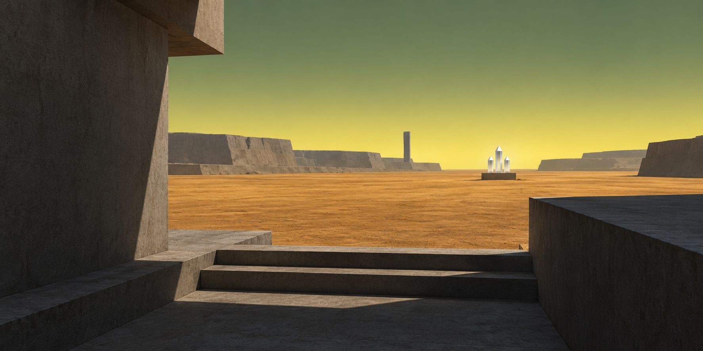
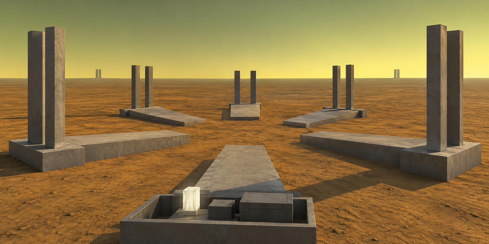
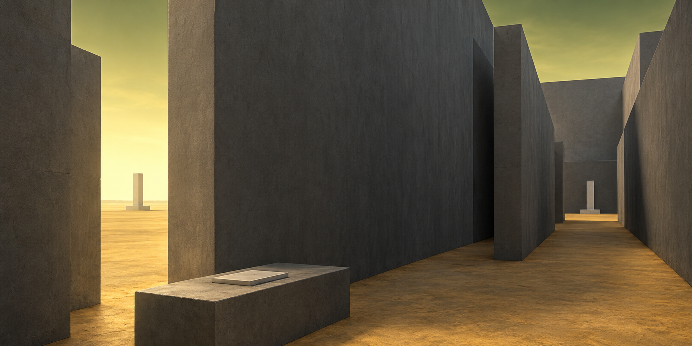

# Atlas illustré des principes de composition

Date : 2026-10-24
Statut : relu et intégré par Codex ; [revue DUO-009](../duo/reviews/DUO-009.md).
Portée : annexe documentaire destinée à un futur guide de composition libre.
Sources lues : les dix fiches `documentation/concept-art/01` à `10` et `documentation/SCENE_FORMAT_V1.md`.

## Statut des images

Les dix images référencées ci-dessous sont des **images conceptuelles produites par l'outil intégré `image_gen`**. Ce ne sont pas des rendus du moteur : aucune scène `.scene`, aucune validation de rendu et aucune mesure de performance n'ont été produites pour cette série. Les fiches le rappellent explicitement pour chacun des concepts.

Ces images ne sont pas non plus des niveaux à sélectionner, ni des scènes préfabriquées prêtes à charger. Ce sont des représentations conceptuelles de maquettes architecturales, destinées à fixer une intention perceptive et un principe de composition. La transposition vers une scène réelle reste un travail de composition séparé.

Le présent atlas synthétise les fiches écrites et distingue leurs intentions des limites observées dans les images. L'exécutant a travaillé à partir des textes ; Codex a revu l'annexe à partir de ces fiches et des images examinées lors de leur création. Le [document historique archivé](../HISTORIQUE_RECHERCHE.md) précise comment transmettre ces principes à le LLM et qualifier leurs effets dans le jeu.

## Comment lire cet atlas

Chaque section suit le même ordre : intention perceptive, composition par primitives, lumière, principe transférable, limite de transposition. La syntaxe de primitive mentionnée est celle du format v1 : `plane`, `box`, et `box rot(...)` pour une boîte orientée en degrés Euler. Les prefabs du format ne supportent pas de rotation explicite ; une forme inclinée se construit donc en boîte, pas en prefab tourné. Les nombres de primitives cités dans les fiches sont des objectifs de conception, jamais des mesures.

## 01 — La chambre du ciel

Fiche : [01-la-chambre-du-ciel.txt](./01-la-chambre-du-ciel.txt)

- **Intention** : une étrangeté produite par l'échelle, les vides et la répétition, plutôt que par un détail spectaculaire.
- **Composition** : des plans pour le sol, des boîtes pour les gradins, les piles, la passerelle et les toitures décalées, la porte n'étant qu'un espacement entre blocs.
- **Lumière** : ciel vert/jaune, rebonds diffus, appoint caméra, occlusion sous les dalles et remontée ocre depuis le fond.
- **Principe transférable** : un vide central monumental devient lisible par une unique invitation étroite, ici la passerelle.
- **Limite** : l'image ajoute grain de matière et joints de béton que les matériaux uniformes actuels ne fournissent pas ; aucun support de textures n'est présupposé.

## 02 — Le champ des diapasons

Fiche : [02-le-champ-des-diapasons.txt](./02-le-champ-des-diapasons.txt)

- **Intention** : déplacer le sujet vers l'espace entre les monuments, avec des silhouettes verticales rares, un rythme irrégulier et un horizon bas sous un ciel occupant la moitié haute.
- **Composition** : des portiques en U — deux piliers et un socle par monument —, des dalles plates pour le chemin et quelques boîtes tournées via `rot(...)`, sur un unique plan de sol ocre et sous un ciel ouvert.
- **Lumière** : diffuse, avec rebonds ocre au sol et appoint blanc discret.
- **Principe transférable** : une répétition espacée et légèrement irrégulière suffit à créer un lieu mémorable sans murs ni toiture.
- **Limite** : la répétition demanderait plusieurs directives explicites ; aucun système d'instanciation n'est présupposé, et le budget de primitives du prompt n'est pas une mesure.

## 03 — La faille en chicane

Fiche : [03-la-faille-en-chicane.txt](./03-la-faille-en-chicane.txt)

- **Intention** : une impression oppressante et comprimée, avec des masses verticales dans un cadre panoramique large et un parcours qui tourne.
- **Composition** : des boîtes pour les murs, les décrochements, les corniches, les parapets et les traverses, avec un plan ocre au fond de la faille ; le passage traverse la tranchée à angle droit.
- **Lumière** : la profondeur doit venir de l'occlusion et des rebonds diffus, la légère impression de brume du concept ne présupposant aucune volumétrie moteur.
- **Principe transférable** : un cadre large peut rester intime si les masses proches bouchent la vue et si la lumière remonte du sol.
- **Limite** : grain, joints et détails de sol ajoutés par le générateur seraient à simplifier en matériaux uniformes.

## 04 — L’escalier de l’horizon

Fiche : [04-lescalier-de-lhorizon.txt](./04-lescalier-de-lhorizon.txt)

- **Intention** : une diagonale ascendante opposée à un horizon immobile, avec une fonction incertaine mais une géométrie entièrement constructible.
- **Composition** : des boîtes empilées marche par marche pour l'escalier, une grande dalle verticale tenue comme une voile et un seuil incomplet de trois blocs, le tout sur un sol ocre plan avec quelques balises.
- **Lumière** : diffuse et latérale, sans soleil dur, avec un espace négatif à droite qui équilibre la montée.
- **Principe transférable** : une seule grande forme oblique suffit à dramatiser un objet utilitaire sans l'entourer.
- **Limite** : les petits cailloux générés sont accessoires et à omettre, et le nombre de marches de l'image n'est pas garanti identique à celui du prompt.

## 05 — L’abri sous la masse

Fiche : [05-labri-sous-la-masse.txt](./05-labri-sous-la-masse.txt)

- **Intention** : jouer le refuge intime contre l'échelle écrasante, avec une asymétrie et une tension portées par la dalle oblique.
- **Composition** : une grande boîte tournée via `rot(...)`, deux appuis massifs, un petit abri assemblé par murs et toiture, un parvis en dalles, une caisse simplifiée et une lampe blanche.
- **Lumière** : la lumière indirecte du ciel et le rebond ocre doivent rendre lisibles les faces sombres du dessous et révéler la porte minuscule, le point le plus clair restant le ciel lointain.
- **Principe transférable** : un surplomb sombre et réellement soutenu produit un abri crédible sans courbe ni forme libre.
- **Limite** : l'ajustement précis des contacts entre la dalle oblique et ses supports reste à construire ; aucun besoin de CSG ni de forme courbe n'est requis.

## 06 — Le signal sur le plateau

Fiche : [06-le-signal-sur-le-plateau.txt](./06-le-signal-sur-le-plateau.txt)

- **Intention** : une distance séduisante et apparemment accessible, où le point lumineux attire à travers un plateau entièrement ouvert.
- **Composition** : deux blocs massifs décalés en premier plan forment une fente sombre, trois marches en boîtes descendent vers la plaine, et le cristal sur son socle sert de destination à droite du centre.
- **Lumière** : une plaine doucement lumineuse s'oppose à l'occlusion grise du premier plan, avec un éclat blanc borné et sans halo.
- **Principe transférable** : un cadre proche et sombre suffit à donner de la valeur à un objectif lointain minuscule.
- **Limite** : les barrières invisibles n'ont aucune géométrie visible et ne doivent jamais devenir une paroi de verre ; les facettes et irrégularités ajoutées aux terrasses lointaines seraient à simplifier en boîtes, éventuellement tournées.

## 07 — Les six directions

Fiche : [07-les-six-directions.txt](./07-les-six-directions.txt)

- **Intention** : une désorientation spatiale à l'intérieur d'une visibilité totalement ouverte, avec six issues également plausibles et aucune route marquée comme correcte.
- **Composition** : des paires de poteaux gris sur de très bas socles et six dalles pointant vers l'extérieur comme une rose des vents brisée, le centre restant libre ; rien ne relie les poteaux, ni linteau ni mur.
- **Lumière** : douce et sans soleil, avec un léger rebond de ciel et une lampe d'arpentage réduite à une boîte émissive blanche.
- **Principe transférable** : l'incertitude de parcours se construit par la répétition de cadres identiques et l'absence de repère privilégié, sans jamais dessiner le labyrinthe.
- **Limite** : le cadrage de l'image montre cinq paires au loin et une sixième direction au premier plan, il ne constitue pas un plan exact à six issues ; l'installation est humaine et ne représente pas les parois aliens.

## 08 — Le jardin des mirages

Fiche : [08-le-jardin-des-mirages.txt](./08-le-jardin-des-mirages.txt)

- **Intention** : un trouble perceptif produit par la perspective seule, sans hallucination graphique ni végétation organique.
- **Composition** : les plantes deviennent des mâts et des lames rectangulaires répétés, avec des orientations légèrement décalées ; les lames inclinées se décrivent par `box rot(...)` et tout reste en boîtes et plans.
- **Lumière** : indirecte, douce et chaude, elle éclaire les dessous des lames tandis que de larges trouées de ciel olive-jaune découpent le haut de l'image.
- **Principe transférable** : un rythme de plaques proches, décalées et chevauchantes suffit à rendre un espace visuellement instable tout en restant physiquement cohérent.
- **Limite** : les appuis et intersections sont à ajuster lors de l'écriture d'une scène ; le concept ne présuppose aucune végétation procédurale.

## 09 — La veille des lumières

Fiche : [09-la-veille-des-lumieres.txt](./09-la-veille-des-lumieres.txt)

- **Intention** : une attention silencieuse et une protection ambiguë plutôt qu'une hostilité, dans un grand espace vide entouré de lumières lointaines.
- **Composition** : des piliers bas surmontés d'un petit panneau blanc émissif, un centre ouvert et traversable, et près de la caméra deux caisses sombres, un cristal minuscule et une tablette.
- **Lumière** : de petits plans émissifs blancs produisent une flaque douce par balise avec un rebond ocre proche, sans bloom, rayon ni brume.
- **Principe transférable** : une couronne irrégulière de sources faibles construit un volume sans murs, par simple distribution de la lumière dans l'obscurité.
- **Limite** : l'image ajoute des joints de dalle et un léger halo aux lampes, éléments non nécessaires à la transposition ; leur éclairage demandera une calibration du rendu.

## 10 — La sortie derrière soi

Fiche : [10-la-sortie-derriere-soi.txt](./10-la-sortie-derriere-soi.txt)

- **Intention** : exprimer une occasion manquée, l'issue étant à quelques pas derrière le prospecteur, visible par le spectateur sans flèche ni explication.
- **Composition** : un mur aveugle massif à droite, une cloison parallèle décalée qui semble fermer la route évidente, et à l'extrême gauche une fente étroite et non encadrée ouverte sur l'horizon jaune-vert.
- **Lumière** : deux tiers froids et sombres contrastent avec un tiers irradiant à gauche, un discret appoint caméra éclairant le cul-de-sac.
- **Principe transférable** : une asymétrie intime entre obstruction et échappée latérale raconte un parcours sans avoir à le cartographier.
- **Limite** : la chicane est une métaphore construite en architecture humaine opaque et ne représente pas les parois invisibles de l'édifice d'origine ; elle ne suppose aucune mutation topologique implémentée.

## Principes transversaux

| Principe | Mise en œuvre dans la série | À surveiller dans une nouvelle scène |
| --- | --- | --- |
| Masses et vides | Peu de volumes, grands, à silhouettes nettes ; le vide central est souvent le vrai sujet | Garder un vide dominant plutôt que remplir la scène de blocs utiles |
| Échelle | Balise blanche, caisse ou tablette minuscules à côté des masses | Placer un repère à taille humaine lisible dans le champ |
| Profondeur | Premier plan sombre, plan intermédiaire bâti, horizon dégagé | Vérifier trois plans distincts sans multiplier les objets |
| Répétition avec variation | Portiques, poteaux, balises ou lames répétés avec espacements et angles irréguliers | Rompre le rythme par un décalage, pas par un nouvel objet |
| Lumière indirecte | Ciel diffus, rebonds ocre, appoint caméra blanc discret, occlusion lisible | Se passer de soleil dur, de halo et de brume volumétrique |
| Ambiguïté de parcours | Six directions, chicane, fente latérale, absence de barrière visible | Distinguer l'ouverture visuelle de l'accès autorisé par le moteur, sans matérialiser une barrière invisible |

## Portée et limites de l'annexe

Cet atlas ne contient pas de code, pas de schéma de runtime, pas de prescription de modèle et aucun résultat de benchmark. Il ne promet aucune similarité garantie entre une future scène et ces images : les surfaces détaillées, les textures et les petits détails visibles dans les concepts ne sont pas garantis par les matériaux actuels du moteur. Les réinterprétations humaines de l'architecture (portiques d'arpentage, balises, abri de prospection) restent distinctes des murs aliens, qui n'ont aucune apparence visible.

La livraison brute de DeepSeek est conservée « À vérifier » dans son worktree ; l'intégration documentaire relève de la revue Codex liée en tête. Aucun test n'a été exécuté par l'exécutant et aucun rendu moteur n'est revendiqué. Les contrôles des liens et des dix PNG sont consignés dans la revue.
