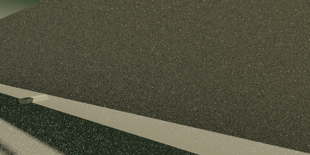
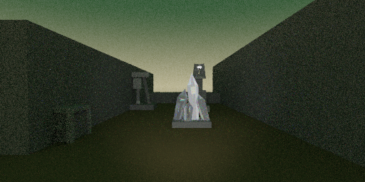
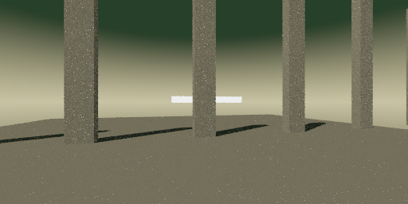
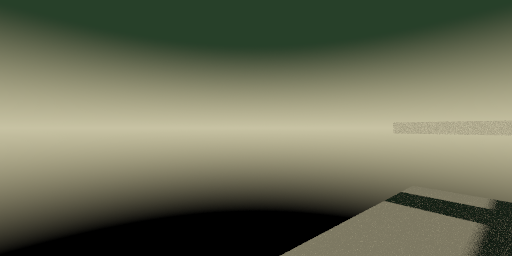

# Pilote des décors dynamiques

Ces images proviennent du vrai raytracer et des essais natifs Ministral. Aucun concept art raster n'est utilisé comme rendu de substitution. La qualification est en cours ; voir le [rapport historique archivé](../../HISTORIQUE_RECHERCHE.md).

## Terrasse : génération directe et hybride

Même brief de calibration `cal_terrace_slot`, graine 77, profil Ministral 8B Instruct Q4, température 0,6, PNG 512 × 256 à 8 échantillons/pixel. Le brief demande une terrasse asymétrique avec parapet à l'ouest, répétition de toits à l'est, fente lumineuse et petit repère décentré. Exécution `pilot-gpu-r8`.

**Voie directe, acceptation technique après une correction.** Le programme est réellement écrit par Ministral. La correction résout un identifiant géométrique dupliqué. Le cadrage reste mauvais : un grand plan remplit la vue, le repère et la terrasse annoncés sont peu ou pas lisibles. Ce résultat illustre pourquoi une scène syntaxiquement correcte et suffisamment éclairée ne suffit pas. [Programme exact](scenes/terrace-direct-r8.scene).

**Référence hybride historique.** Le LLM propose les métadonnées, puis le compositeur existant produit les volumes. Le cadrage est plus lisible, mais il ne restitue pas fidèlement la terrasse demandée. Cette image ne compte pas comme une scène libre du nouveau mode. [Programme exact](scenes/terrace-hybrid-r8.scene).

La voie en deux passes de cette même variante a été rejetée : le repère déclaré n'existait pas dans la liste des groupes. Elle n'a donc aucune image acceptée à présenter. Cette erreur a motivé la description obligatoire du repère avant les groupes secondaires dans le contrat d'auteur suivant.

## Deux autres limites de la voie directe

`cal_night_ring`, graine 77 : acceptée au premier appel, mais la nuit et la cour circulaire demandées ne sont pas restituées. Les piliers sortent du cadre, le panneau lumineux est visible au loin. [Programme exact](scenes/night-direct-r8.scene).

`cal_oblique_steps`, graine 77 : acceptée après deux corrections. La vue reste largement vide, l'escalier et la tour ne composent pas le cheminement annoncé. [Programme exact](scenes/steps-direct-r8.scene).

Ces deux vues utilisent aussi 512 × 256 pixels et 8 échantillons/pixel. Le contrôle direct, dépourvu de plan, n'a pas les vérifications de visibilité des groupes et des passages de la voie en deux passes.

Revue visuelle par Codex, méthodes connues. Aucun score humain à l'aveugle ni gain artistique général n'est revendiqué. Les programmes n'ont pas été retouchés pour obtenir ces images et ne sont jamais servis au joueur comme catalogue de niveaux.
