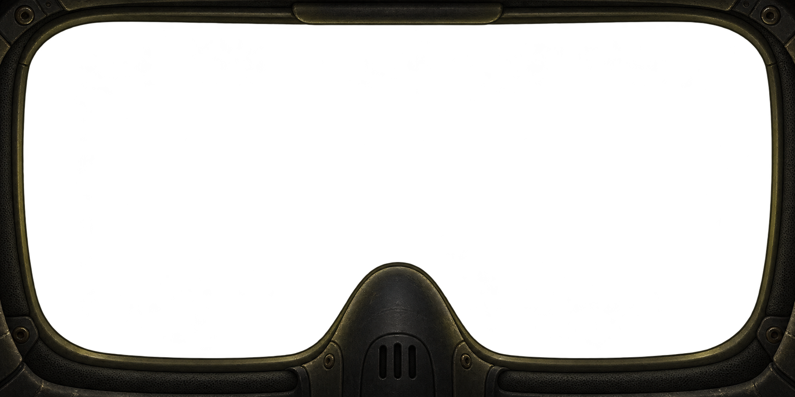

# Masque de scaphandre — intérieur bitmap, v1

Proposition du 25 octobre 2026, générée avec l'outil intégré imagegen.



Référence de proportions : `img/2026-10-25_202500.png`, zone de visière seulement.
PNG RGBA, format panoramique 2:1, ouverture transparente. Les joints en caoutchouc,
le rembourrage sombre et les fixations suggèrent l'intérieur du scaphandre ;
le respirateur conserve la remontée centrale du masque actuel.

Cette proposition conserve globalement la silhouette, sans garantir un contour
identique au pixel près. Le cadre inférieur est un peu plus présent. Le HUD doit
rester indépendant, dessiné par le jeu dans la langue choisie. Asset conceptuel,
sans modification du runtime ni intégration dans le rendu.

## Prompt de génération

```text
Use case: stylized-concept.
Asset type: a single bitmap RGBA overlay for the INSIDE of a spacesuit helmet in a first-person literary exploration game.
Input image: the supplied screenshot is a GEOMETRY REFERENCE only. Extract the proportions of the visor area only, approximately x=58..1344 y=71..713 of the screenshot. Do not reproduce the whole application.
Primary request: replace the plain black visor silhouette with a more tangible helmet interior, while keeping essentially the same footprint and broad 2:1 horizontal format.
Output: one landscape 1536x768 PNG with real transparency through the visor aperture. Only helmet interior is opaque. No scenery, no lettering, no UI, no compass, no temperature labels, no desktop frame. Do NOT draw a checkerboard.
Geometry is the first priority: a very large near-rectangular clear viewing aperture with rounded corners (corner radius roughly 12% of image height); thin perimeter frame hugging the canvas edges, about 2–4% of image height along the top, 2–3% of width at the sides, and a slim bottom rim. Most of the bitmap is genuinely transparent. Keep the lower left and lower right open for the existing HUD. At the exact bottom centre a narrow rounded nose/respirator housing rises into the opening: its summit at about 68% of canvas height, and its base spans approximately x=41%..59%. Preserve this upright domed silhouette from the reference, do not expand it into a huge breathing apparatus. Nothing protrudes from the top centre. No face, eyes, nose or person.
Style: convincing close-up interior materials, restrained worn industrial science fiction, practical exploration helmet. Extremely dark charcoal rubber seals in two or three shallow concentric lips, matte black padded inner lining, a few discreet dark metal fasteners at the outer corners, fine molded grain and subtle wear. The central housing has the same curved domed silhouette, a soft rubber nose bridge, small recessed ventilation slits and understated assembled seams; no giant hoses. Soft muted warm olive reflected highlights on the edges, very low brightness, substantial shadows. An intimate enclosed sense of being inside a real helmet, rather than looking at the exterior of a helmet. Symmetrical underlying geometry, subtle natural material imperfections. Clean antialiased alpha edge.
Keep the aperture nearly as broad as in the reference; avoid thick framing, busy greebles, bright trim, neon, shiny chrome, oversized gasmask, added text, decorative symbols, scenery or glass haze across the clear centre.
```
