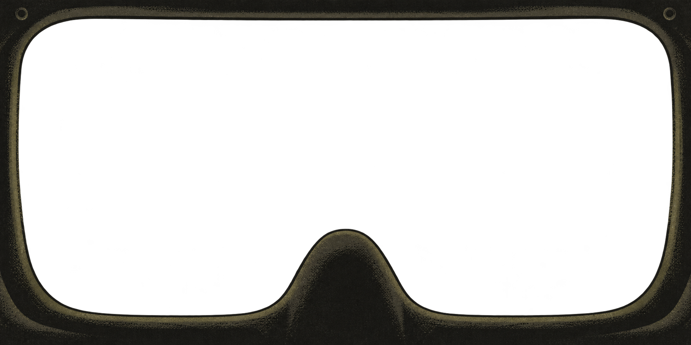

# Masque de scaphandre — intérieur suggéré, v2

Variante générée le 25 octobre 2026 avec l'outil intégré imagegen.



PNG RGBA 1774 × 887, ouverture transparente ; proportions et remontée centrale
conservées globalement. La v1 reste disponible pour comparaison.

Direction : silhouette sombre, aplats olive et charbon, grain irrégulier et quelques
accents de contour. Les évents détaillés, rembourrages modernes et reflets réalistes
laissent place à une évocation de caoutchouc et de toile. Inspiration libre des
appareils respiratoires et équipements d'expédition des années 1930, cohérente avec
l'époque de la nouvelle ; ce n'est pas une reconstitution d'un modèle historique.

Références : v1 pour les proportions, `img/2026-10-25_202500.png` pour l'esthétique
du jeu. Concept seulement : aucune modification du HUD ou du rendu du jeu.

## Prompt de génération

```text
Use case: style-transfer.
Create a revised transparent PNG bitmap overlay, version 2, for the inside of a fictional exploration helmet.
Image 1 is the edit target: preserve its broad 2:1 format, rounded rectangular aperture and bottom-centre domed nose silhouette. Image 2 is the game's aesthetic reference: sparse massive shapes, muted olive/ochre, grainy low-detail rendering, black graphic framing.
The user finds image 1 too photorealistic. REDESIGN ITS VISUAL LANGUAGE: greatly simplify the mask into an understated near-black graphic silhouette with only a few broad painted planes and fine, irregular dithered grain. It should barely suggest the inside of a breathing mask, not show a detailed rendered product. Approximately 80–90% of the opaque surface stays flat deep charcoal. Only 2 or 3 muted olive-grey tonal levels reveal a rubber lip, a soft fabric fold and a small simple nose housing. Sparse broken edge accents, no detailed shiny 3D shading.
Period art direction: speculative expedition apparatus as imagined in 1930s weird fiction, pre-war rubber respirator and canvas/leather sealing, austere utilitarian industrial forms, restrained hand-painted pulp illustration translated into a minimal early-computer-game bitmap. No modern tactical equipment, molded ergonomic sports padding, futuristic electronics or space-age ornament. Avoid decorative steampunk, brass machinery and ornate rivets. At most two or four very faint plain circular fastening marks, almost lost in shadow.
Keep the same overall silhouette but make the frame visually quieter and a little thinner, especially at the bottom. Large clear viewport; lower left and right remain usable for the game's separately rendered HUD. The central domed intrusion rises to about 68% of canvas height, bottom width about 18% of canvas. Make it a simple dark rubber shape suggested by a single muted edge and perhaps one flat shadow plane, not a chrome mechanical respirator; remove the conspicuous vents and screws from v1.
Deliver a single wide 2:1 PNG with TRUE alpha transparency in the entire viewing aperture. Entire centre fully clear, no scenery or simulated glass. No text, numbers, labels, compass, lights, UI, paper background, checkerboard or decorative illustration outside the frame. This is a usable bitmap overlay concept, not a poster or screenshot. Keep the canvas framing and edge geometry approximately matched to image 1. The visual should merge into the game's sparse sombre granular scene, not compete with it.
```
