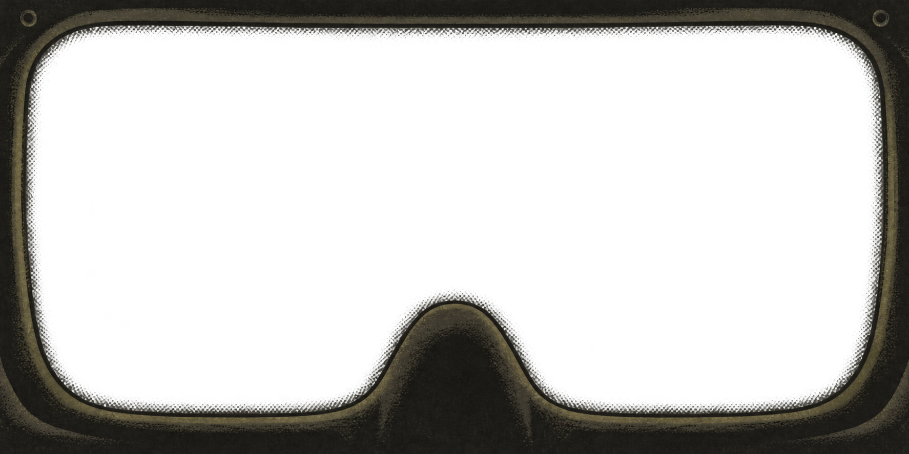

# Masque de scaphandre — transition tramée, v3

Variante du 26 octobre 2026, générée avec l'outil intégré imagegen à partir de la v2.



PNG RGBA 1774 × 887, format 2:1. Une fine transition de points sombres accompagne
le bord intérieur du joint, y compris le contour de la remontée centrale. La trame
se dissipe vers l'ouverture transparente, en évoquant le pourtour d'un pare-brise.
Le centre reste entièrement transparent, sans teinte de verre ajoutée.

Palette sombre et style suggéré de la v2 conservés globalement. Les versions
précédentes restent disponibles. Intégration du 26 octobre 2026 : copie exacte
dans `assets/masque-scaphandre-interieur-v3.png`, chargée par le frontend SDL
à la place du masque procédural, avant le HUD.

## Prompt de génération

```text
Use case: precise-object-edit.
Input image is the exact edit target: version 2 of a transparent bitmap helmet interior overlay. Make version 3 with ONE local change only.
Add a SUBTLE NARROW DITHERED TRANSITION at the inner junction of the dark rubber seal and the transparent visor aperture, reminiscent of the graduated ceramic frit dots around an automotive windshield.
Keep the original composition, 2:1 landscape canvas, rounded rectangular aperture, central bottom nose dome, all opaque frame artwork, sparse olive-charcoal palette and non-photorealistic grainy painted style essentially unchanged. Do not redesign the mask or add hardware.
The new transition follows the COMPLETE inner perimeter continuously: top, sides, rounded corners, bottom and over both sides and top of the central nose dome. Extend a narrow band roughly 12–22 pixels inward into the originally transparent aperture at the source image's 1774x887 resolution. Small near-black charcoal dots in a restrained regular staggered halftone pattern, dense and nearly merging against the gasket, then progressively smaller and sparser towards the clear glass until there are no dots. About 4 to 6 subtle rows. No bright dots or light outline. This is a dotted transition of COVERAGE INTO ALPHA, not a grey opaque strip and not a painted gradient on an opaque background.
True transparency between all separated dots; the entire central aperture remains fully alpha=0. Keep clean antialiased dots. The effect should soften the hard cutout into the clear opening while preserving the minimalist mask's footprint and unobstructed view. Do not add any glass tint, scenery, checkerboard, white background, glow, reflections, text, HUD, UI, or paper texture in the aperture. Preserve the existing opaque edge textures outside this one narrow transition. Output one transparent RGBA PNG, same wide 2:1 aspect ratio as input.
```
