# Concepts 01, 02, 03 et 09 — essais avec le raytracer actuel

Date : **24 octobre 2026**. Scènes composées manuellement par Codex, puis calculées avec le renderer natif. Première série avec le moteur initial ; seconde série après l’ajout de la lumière directionnelle demandé pendant l’essai. Aucune génération d’image par IA pour les reconstructions.

**Les grandes structures sont réalisables avec le langage actuel. Les rendus restent sensiblement différents des concepts : cadrages approximatifs, lumière moins travaillée, matières uniformes et bruit visible.** Cet essai ne démontre pas un plafond de qualité du moteur. Il permet de distinguer les réglages encore possibles des propriétés effectivement absentes du format.

[Ouvrir le comparateur interactif local](compare.html) — curseur concept/rendu, vue côte à côte et choix du profil. Les PNG sont aussi consultables directement ci-dessous.

## 1. Comparaisons avec le moteur initial

Les concepts originaux font **1774 × 887** ; les rendus « qualité » font **960 × 480**, toujours en **2:1**. L’affichage les met à la même largeur ; les fichiers de rendu ne sont ni agrandis, ni retouchés, ni débruités. Le grain de calcul ne doit pas être confondu avec la texture du béton.

### 01 — La chambre du ciel

| Concept | Raytracer — 128 échantillons/pixel |
|---|---|
| 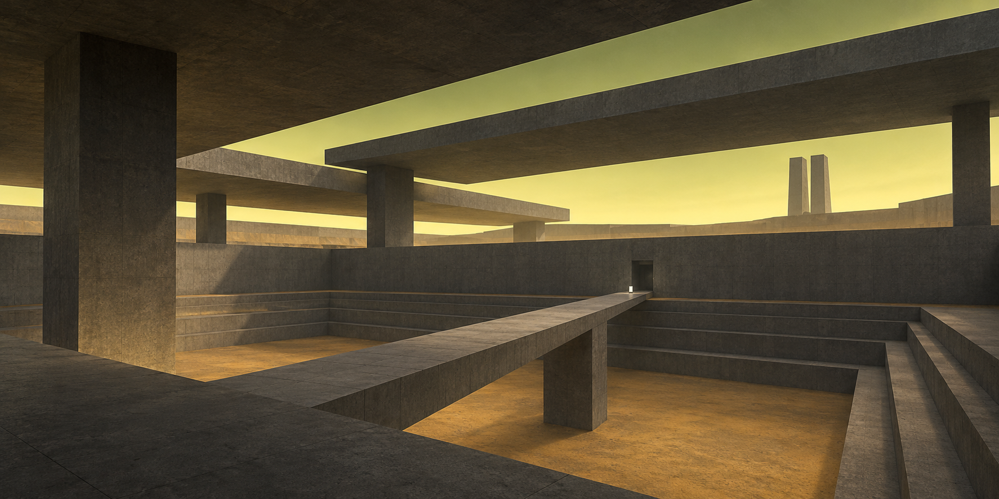 | 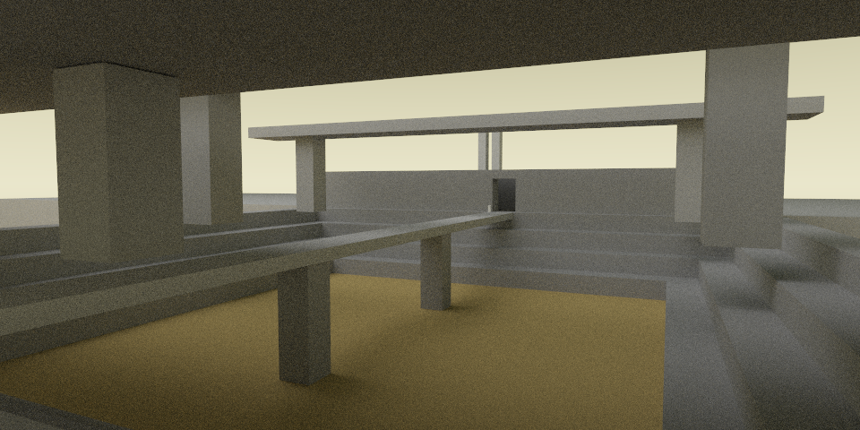 |

[Scène 01](scenes/01-la-chambre-du-ciel.scene) · [Rendu léger](renders/budget/01-la-chambre-du-ciel.png)

**Reproduit :** cuvette à gradins, passerelle étroite, piles carrées, toitures séparées par des ouvertures, petite porte au fond. Tout est composé de boîtes et de plans ; l’ouverture est l’espace laissé entre les blocs.

**Écarts :** la passerelle entre davantage par le bord gauche ; la perspective et les proportions des toitures ne sont pas celles de la référence. Le sol et les sous-faces restent moins chaleureux, le béton est uniforme. Déplacer caméra, piles et dalles peut rapprocher la composition sans ajouter de fonction au renderer.

### 02 — Le champ des diapasons

| Concept | Raytracer — 128 échantillons/pixel |
|---|---|
| 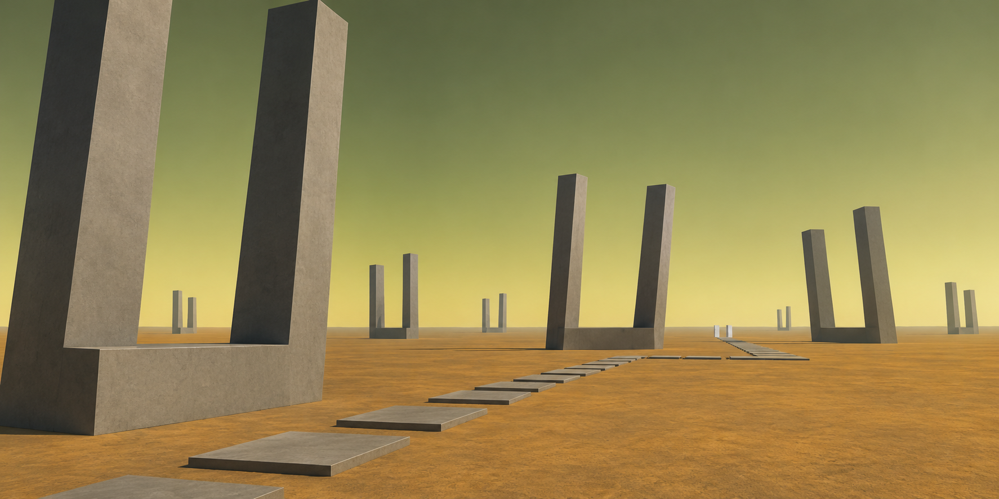 | 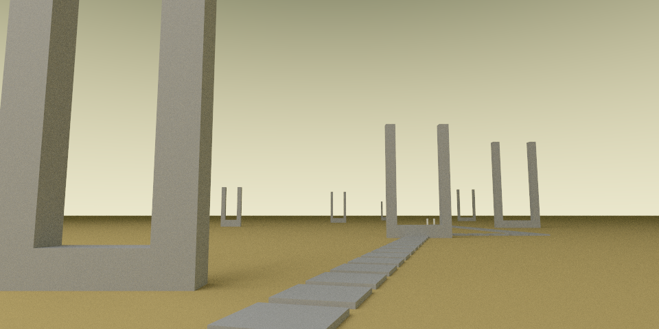 |

[Scène 02](scenes/02-le-champ-des-diapasons.scene) · [Rendu léger](renders/budget/02-le-champ-des-diapasons.png)

**Reproduit :** neuf diapasons formés de trois boîtes chacun, forte différence d’échelle entre premier plan et horizon, chemin de dalles avec changements de direction, grand vide central.

**Écarts :** les objets éloignés se tassent davantage près de l’horizon ; les ombres sont moins dessinées, l’ocre et le ciel moins saturés. L’orientation de la lumière et l’espacement des structures restent à affiner. Ce cas ne justifie ni maillage complexe ni nouvelle primitive.

### 03 — La faille en chicane

| Concept | Raytracer — 128 échantillons/pixel |
|---|---|
| 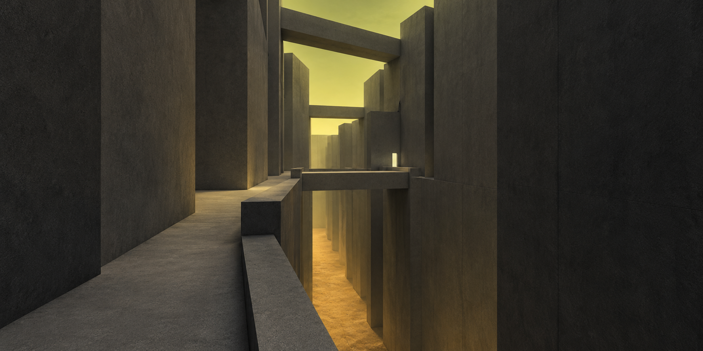 | 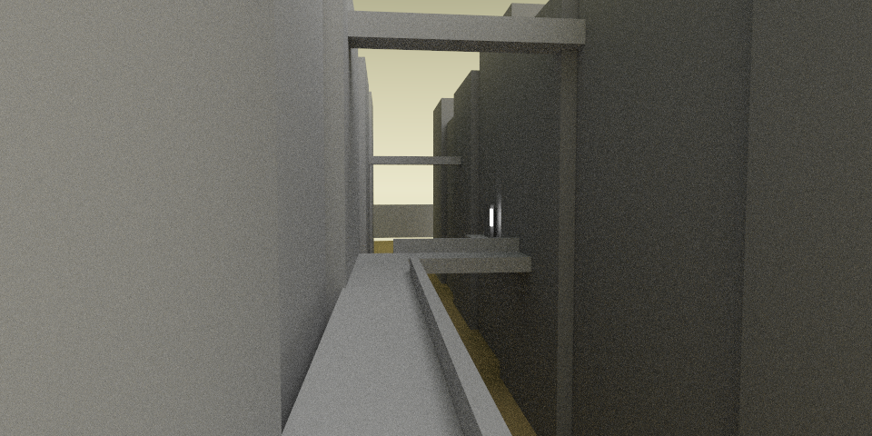 |

[Scène 03](scenes/03-la-faille-en-chicane.scene) · [Rendu léger](renders/budget/03-la-faille-en-chicane.png)

**Reproduit :** deux rangées de parois, coursive à gauche, traversée à angle droit, vide sous le passage, deux traverses hautes et balise près de la sortie.

**Écarts importants :** le point de vue écrase la chicane et montre moins bien la profondeur de la faille. La paroi gauche est trop uniformément éclairée ; le fond reçoit moins de lumière ocre que dans le concept. C’est la reconstruction architecturale la moins convaincante du lot. Il faut reprendre les rapports largeur/profondeur, les décrochements des murs et le cadrage avant d’attribuer cet écart à une fonction manquante.

### 09 — La veille des lumières

| Concept | Raytracer — 128 échantillons/pixel |
|---|---|
| 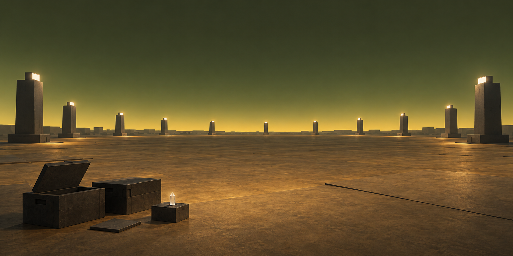 | 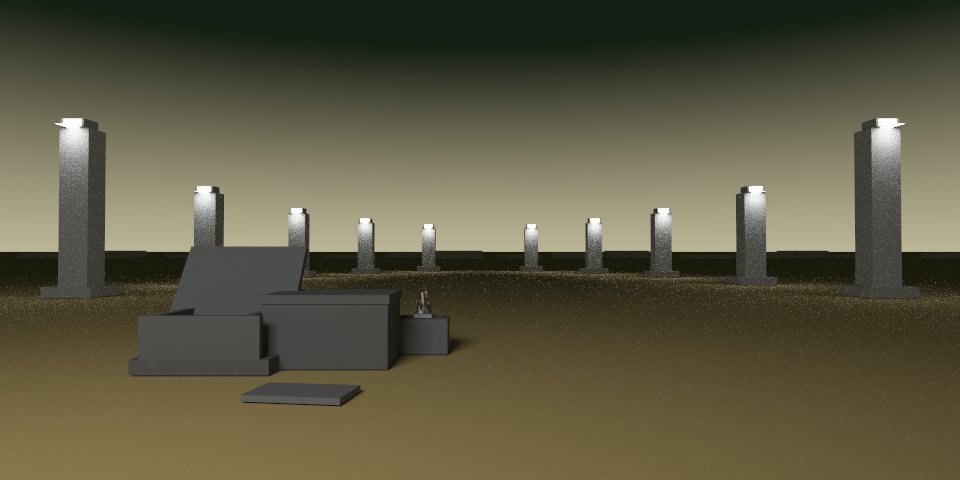 |

[Scène 09](scenes/09-la-veille-des-lumieres.scene) · [Rendu léger](renders/budget/09-la-veille-des-lumieres.png)

**Reproduit :** dix balises en demi-cercle, silhouette plus haute sur les bords, plateau vide, deux caisses dont un couvercle tourné, tablette et petit cristal sur un socle.

**Écarts :** horizon moins doré, sources blanches plus dures, répartition des taches lumineuses et proportions des accessoires différentes. Le sol reste mat et uniforme : le léger reflet étalé et les variations de matière du concept ne sont pas décrits par le modèle diffus actuel. Le cristal utilise le prefab existant de cinq éclats, sans émission propre dans la version retenue.

## 2. Conditions de l’essai

Les quatre fichiers sont des **fixtures de calibration**. Ils ne sont pas ajoutés à la route jouable, ne remplacent pas les salles du jeu et n’ont pas été produits par le LLM. Ils ne constituent pas un catalogue de niveaux pour le futur système dynamique.

- Géométrie : `box`, `box rot(...)`, `plane` et un `prefab_crystal_cluster` pour 09.
- Matériaux : uniquement `gray`, palette sémantique existante, `emit` et verre du prefab.
- Ciel : `sky` actuel, valeurs de luminance et largeur du dégradé ajustées ; bruit du ciel et étoiles désactivés pour isoler les effets du rendu.
- Éclairage : ciel, spot attaché à la caméra et sources émissives explicites.
- Pour 01, 02 et 03, un grand plan lumineux blanc est placé hors du cadrage pour fournir une lumière douce. Il figure dans chaque fichier sous le nom `study_soft_key`. **Ce ne sont donc pas des essais éclairés uniquement par le ciel.** Le spot caméra est également décalé pour servir de lumière de remplissage.
- Pour 09, chaque balise possède deux petits plans émissifs : façade visible et éclairage vers le sol. Le spot caméra rend les accessoires lisibles.
- Sortie : PNG natif du CLI, sans visière, HUD, traitement SDL, correction colorimétrique externe ou débruitage.

Ces lumières sont de la scène 3D ordinaire. Elles permettent d’étudier la capacité d’image du langage ; leur déplacement avec une caméra mobile et leur cohérence avec l’univers restent à qualifier avant un usage dans le jeu.

### Profils calculés

| Paramètre | Qualité | Budget réduit |
|---|---:|---:|
| Dimensions | 960 × 480 | 800 × 400 |
| Échantillons/pixel | 128 | 16 |
| Limite diffuse `--bounces` | 5 | 3 |
| Limite verre | 9 | 9 |
| Échantillons directs | 8 | 2 |
| Exposition / graine | 1 / 1337 | 1 / 1337 |
| Threads OpenMP | 12 | 12 |

Le profil réduit reprend les valeurs de profondeur et d’échantillonnage de `RenderConfig`. Ce n’est pas un chronométrage de partie SDL : ni inférence, ni animation, ni interface. Les deux profils font varier plusieurs paramètres ; ils ne constituent pas une expérience isolant le seul nombre d’échantillons.

| Scène | Triangles | Matériaux | Triangles émissifs | Qualité (s) | Budget (s) |
|---|---:|---:|---:|---:|---:|
| 01 | 448 | 39 | 2 | 246.27 | 5.39 |
| 02 | 832 | 71 | 2 | 38.87 | 0.98 |
| 03 | 304 | 27 | 14 | 259.20 | 6.28 |
| 09 | 858 | 84 | 40 | 64.11 | 1.82 |

Machine de mesure : **Intel Core i7-10700, 8 cœurs / 16 threads logiques**, calcul CPU avec 12 threads OpenMP. Les durées sont celles du renderer, relevées dans sa sortie. Un seul passage final par scène et par profil ; charge système non isolée (une compilation a notamment recoupé la fin du premier profil qualité). Ces valeurs sont indicatives, sans médiane ni garantie de latence.

Les manifestes [qualité](renders/quality/results.json) et [budget](renders/budget/results.json) conservent les paramètres, nombres de triangles/matériaux, durées, empreintes des scènes, du binaire et des PNG. Le commit indiqué est celui du dépôt lors du lancement ; les scènes nouvelles sont identifiées par leur propre empreinte.

Binaire utilisé : `build/Release/liminal_cornell_renderer.exe`, SHA-256 `e08221359bb7689a5395f3d9749e274aeeed486c16f8df6ef169db1b854b4169`. Binaire existant réutilisé, sans nouvelle compilation. Les fichiers moteur de cette référence étaient identiques entre la base d’audit `bd4306f` et le commit documentaire `c1bfcb7`. Les modifications non commitées ajoutent ensuite la lumière directionnelle ; les manifestes permettent de distinguer les deux binaires.

## 3. Ce qui manque vraiment — et ce qui demande encore du travail de scène

Cette table décrit les constats de la première série, avant l’ajout du soleil présenté en section 6. Les constats de code sont détaillés dans l’[audit relu des capacités](CAPABILITIES_AUDIT.md). Les conséquences visuelles ci-dessous restent qualitatives : aucun score de similarité ni optimum de reconstruction n’est revendiqué.

| Sujet | Constat | Conséquence / priorité proposée |
|---|---|---|
| Géométrie principale | Les quatre compositions chargent et se rendent avec des boîtes/plans. | **Pas d’ajout de primitive requis pour ce lot.** D’abord améliorer cadrages, proportions et assemblages. |
| Illumination globale | Les chemins diffus rebondissent et reçoivent le ciel lorsqu’ils quittent la géométrie. | **La GI existe déjà.** Calibrer éclairage et exposition avant de conclure à son absence. |
| Soleil | Pas de source directionnelle indépendante de la caméra dans le moteur initial. Les panneaux lointains ne sont qu’une approximation finie. | **Manque confirmé et traité pendant cet essai** : ajout de `distant_light`, voir section 6. |
| Couleur | Les teintes du ciel et des matériaux sont codées dans le moteur ; le langage pilote surtout leurs luminances. Les émissions ordinaires sont blanches. | L’horizon soufré reste contraint. La nouvelle `distant_light` permet désormais une lumière chaude colorée ; les palettes de ciel et de matériaux restent un sujet distinct. |
| Noms de matériaux | `bridge` contient `ridge` et déclenche la teinte désert. Ce piège a été rencontré et corrigé dans les essais en renommant les passerelles. | Rendre le matériau explicite ou valider les noms ; ne pas laisser une dénomination innocente décider du rendu. |
| Convergence | Bruit visible dans les zones indirectes et autour des petites lampes. Les lumières sont tirées uniformément parmi les triangles émissifs. | Qualifier un échantillonnage selon la puissance/surface et un échantillonnage explicite du ciel ; mesurer les gains, puis envisager un débruiteur. |
| Béton et sol | Un albédo uniforme ; pas de texture, normale de détail, rugosité ou reflet spéculaire pour les matériaux ordinaires. | Vraie limite pour les matières des concepts. Une variation procédurale sobre et un matériau spéculaire rugueux seraient des extensions ciblées. |
| Joints et détails | Les joints peuvent être construits avec des boîtes ; ceux du concept n’ont pas été tous reproduits. | Ce détail n’est pas une preuve de manque du langage ; attention au coût en géométrie. |
| Halos et atmosphère | Pas de bloom ni de volume atmosphérique dans ce rendu CLI. | Quelques différences visuelles possibles, mais ces effets ne sont pas nécessaires aux silhouettes et ne sont pas prioritaires ici. |
| Validation du langage | Une propriété inconnue peut être ignorée ; un chargement réussi ne garantit pas que la propriété agit. | Refuser ou signaler les propriétés inconnues dans la future génération LLM. |

Le [ciel](../../../src/renderer.cpp) utilise `SampleSkyBackground`, les rebonds `TracePath`, les lumières `EstimateEmissiveTriangleLighting`. Les [matériaux](../../../src/scene.cpp) passent par `InferMaterialSemantic` et `BuildSemanticAlbedo` ; leur structure est définie dans [core.h](../../../src/core.h).

### Exemple concret : les lumières de 09

Un premier montage contenait **260 triangles émissifs** : dix lampes en boîtes, dix plans descendants et un cluster lumineux. Le montage retenu en contient **40** : deux plans par balise et cristal non émissif. Le nombre total de triangles passe de **958 à 858**.

Cela évite de consacrer une grande partie des tirages à un petit cristal ou aux faces peu utiles d’une boîte. Le PDF du renderer compense bien la probabilité de sélection : compter plus de triangles ne multiplie pas automatiquement l’énergie. Le problème est l’efficacité des tirages.

Les dimensions, intensités et positions ont aussi changé entre ces essais. La comparaison ne permet donc pas d’attribuer un gain chiffré au seul remplacement des lampes. Elle fournit une règle de construction à tester : **peu de surfaces émissives, bien orientées, avec une aire cohérente avec leur rôle**. Un plan peut paraître lumineux des deux côtés à la caméra, mais son éclairage direct dépend de sa normale.

## 4. Conséquence pour le système dynamique

Ces résultats renforcent le besoin d’un **plan spatial**, d’un contrôle de caméra et d’un aperçu de rendu dans le [document historique archivé](../../HISTORIQUE_RECHERCHE.md). Une bonne liste d’objets ne suffit pas à produire une bonne image.

1. Commencer DYN-01/DYN-02 avec le langage existant, en donnant au modèle des règles de composition, d’échelle, de matière et d’orientation des sources.
2. Conserver ces quatre scènes comme références humaines du banc : comparer une scène inventée par le LLM à une qualité atteignable avec le moteur, en plus des concepts.
3. Prioriser cadrage et visibilité des masses ; contrôler les noms sémantiques et le nombre de triangles émissifs.
4. Mesurer qualité et durée à un budget compatible avec le jeu. Une image lente de calibration n’établit pas la viabilité de la boucle interactive.
5. Ouvrir ensuite des lots séparés pour les propriétés explicitement absentes : palettes contrôlées, matériaux sobres plus riches, puis amélioration de convergence. Ne pas mélanger leur évaluation avec celle du raisonnement du modèle.

Le résultat attendu reste un lieu **inventé pendant la partie**, décrit en `.scene`, validé et rendu. Ces reconstructions servent à apprendre ce qu’il faut demander au modèle et ce qu’il faut mesurer.

## 5. Reproduire

Depuis la racine du dépôt, avec le renderer Release déjà disponible :

```powershell
python documentation/concept-art/raytracer-study/render.py --label quality-recheck --width 960 --height 480 --samples 128 --bounces 5 --direct-samples 8 --threads 12
python documentation/concept-art/raytracer-study/render.py --label budget-recheck --width 800 --height 400 --samples 16 --bounces 3 --direct-samples 2 --threads 12
```

Le [script](render.py) accepte `--cases 01 03`, `--renderer`, `--output-root` et `--logs-root`. Il refuse d’écraser un dossier de run existant. Les journaux bruts, commandes et copies exactes des entrées sont rangés hors dépôt, par défaut dans `C:/works/duo-runs/game-liminal-raytraced-llm-world/CONCEPT-RENDER-01/`.

Les étapes exploratoires `preview-a` à `preview-e` restent dans ce dossier externe. Le dépôt contient les quatre entrées initiales, leurs deux profils, puis trois variantes diurnes avec soleil. La [revue DUO-010](../../duo/reviews/DUO-010.md) précise la contribution de l’audit délégué ; les scènes, réglages, rendus et conclusions comparatives ont été réalisés par Codex.

## 6. Ajout demandé : une lumière directionnelle à l’infini

L’absence de soleil était bien un manque de l’interface d’éclairage. La directive [distant_light](../../SCENE_FORMAT_V1.md) a été ajoutée au chargeur et au renderer pendant cet essai :

```text
distant_light direction(-0.6,-1,0.35) intensity(3.5) color(1,0.88,0.55) angular_radius(0.65)
```

`direction` suit le trajet **soleil → scène**, dans le monde. La source n’a pas de position, ne suit pas la caméra et ne faiblit pas avec la distance. `angular_radius(0)` donne des ombres nettes ; une petite valeur positive permet une pénombre. Les ombres passent par le test d’occultation existant, y compris la transmission du verre. L’énergie reçue sur une surface face à la lumière reste constante lorsque son rayon angulaire change.

La lumière participe aux rebonds diffus. Elle n’ajoute ni géométrie, ni disque solaire visible, ni reflet direct d’un disque dans le verre. Le ciel jaune/vert reste un fond indépendant ; son dégradé n’est pas modifié par cet ajout.

### Essais avec soleil

Même géométrie architecturale, même caméra, mêmes matériaux et même ciel que les fichiers initiaux. Le grand panneau d’appoint et le spot caméra sont retirés des trois variantes ; le soleil prend leur place. Ce protocole compare deux éclairages complets, pas l’ajout d’une source à énergie totale constante. La scène 09 reste nocturne, sans soleil.

| Scène | Nouveau rendu avec soleil | Fichier |
|---|---|---|
| 01 | 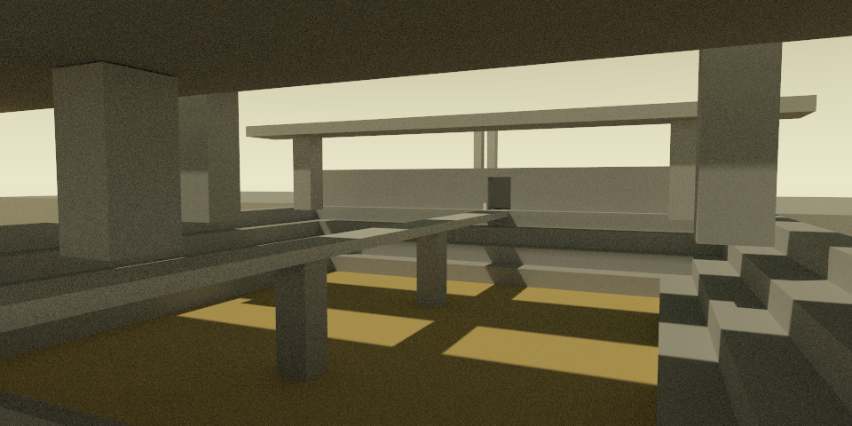 | [Scène avec soleil](scenes-sun/01-la-chambre-du-ciel.scene) |
| 02 | 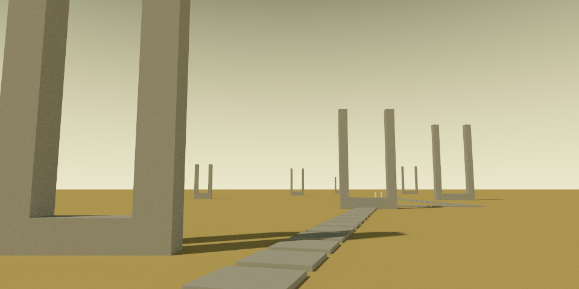 | [Scène avec soleil](scenes-sun/02-le-champ-des-diapasons.scene) |
| 03 | 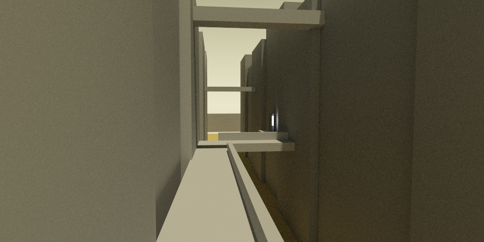 | [Scène avec soleil](scenes-sun/03-la-faille-en-chicane.scene) |

Rendus natifs **960 × 480 / 128 échantillons**, 5 événements diffus, 8 tirages directs, 12 threads. Construction de rendu dédiée (sans SDL ni llama.cpp), mêmes sources de rendu que le runtime complet. Compilation du runtime en parallèle : **ces durées ne permettent pas de conclure à un gain de performance**.

| Scène | Triangles | Émissifs | Durée (s) |
|---|---:|---:|---:|
| 01 | 446 | 0 | 139.37 |
| 02 | 830 | 0 | 32.12 |
| 03 | 302 | 12 | 250.62 |

Binaire de calcul : `build_distant_light/Release/liminal_cornell_renderer.exe`, SHA-256 `01238440b69b578aa1242a1e76f82811dbb11c41f610b3afa015d6bf75e5925e`.

**Effet observé sur les rendus :** les diapasons projettent des ombres cohérentes et longues ; les gradins et la passerelle de 01 découpent clairement le sol. La faille retrouve une séparation plus directionnelle entre parties exposées et zones abritées. La lumière ne corrige toutefois ni la perspective de 03, ni la palette du ciel, ni l’absence de détail de matière. Les zones indirectes restent bruitées.

Les fichiers du moteur, le format de scène et le test natif sont modifiés ; les scènes canoniques, les modèles et le compilateur hybride ne sont pas changés. Le soleil n’est donc pas activé automatiquement dans les lieux actuels. Le futur générateur pourra le demander en écrivant cette directive.

### Validation de l’ajout

- Tests natifs : parsing et rejets de paramètres invalides, remise à zéro au rechargement, direction, absence d’atténuation, occultation, pénombre, conservation d’énergie, couleur et rebond diffus. [Test](../../../tests/distant_light_test.cpp).
- Régression des quatre scènes initiales en 800 × 400 / 16 échantillons : PNG **identiques octet par octet** entre l’ancien renderer et la construction intégrant le soleil désactivé.
- Build complet Release avec SDL3, llama.cpp et CUDA réussi ; **2/2 tests CTest** et **3/3 auto-tests** (animation, navigation, post-traitement) réussis. Deux rendus de contrôle du runtime complet, avec et sans soleil, sont identiques aux références de calcul correspondantes. Exécutable validé copié dans `build/Release/liminal_cornell_renderer.exe`, SHA-256 `e42b55154d9df58b1d405ef2b9bdc1edf1c5d46ad266c27962cad208b65622b3`. L’installeur n’a pas été reconstruit.

Contrôle des livrables : **11 PNG** décodés, ratios 2:1, dimensions et empreintes des images/scènes conformes ; **62 liens locaux** vérifiés dans le comparatif, l’audit, la revue et la page HTML.

Reproduire les trois variantes avec le nouveau renderer :

```powershell
python documentation/concept-art/raytracer-study/render.py --label sun-recheck --cases 01 02 03 --scene-root documentation/concept-art/raytracer-study/scenes-sun --renderer build/Release/liminal_cornell_renderer.exe --width 960 --height 480 --samples 128 --bounces 5 --direct-samples 8 --threads 12
```

[Manifeste des rendus avec soleil](renders/sun/results.json). Les journaux de construction et de tests sont conservés hors dépôt dans `C:/works/duo-runs/game-liminal-raytraced-llm-world/DISTANT-LIGHT-01/`.
