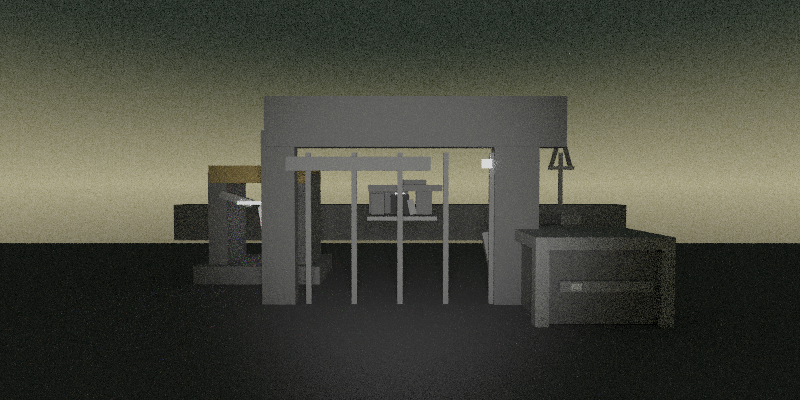
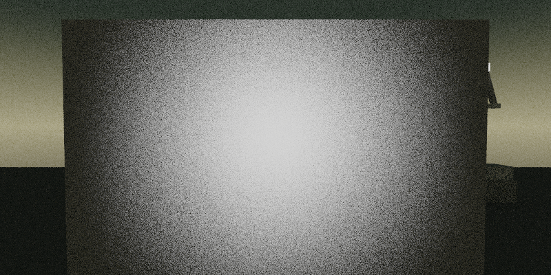
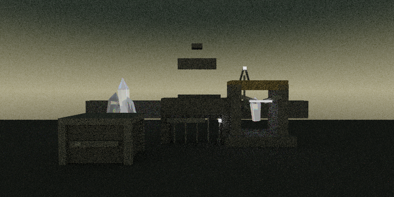
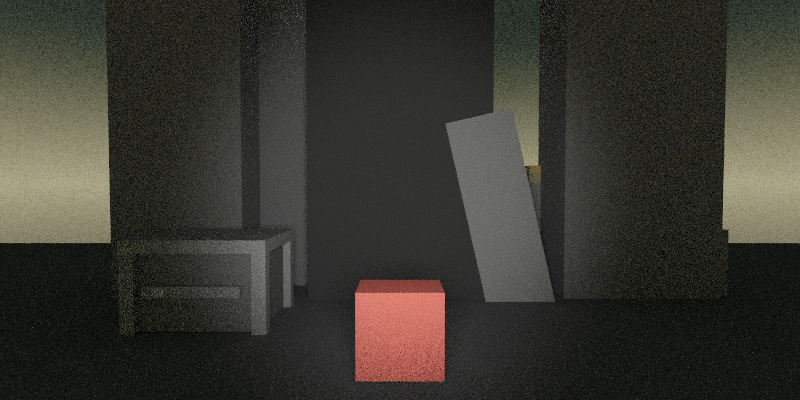
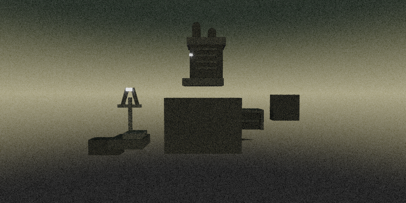
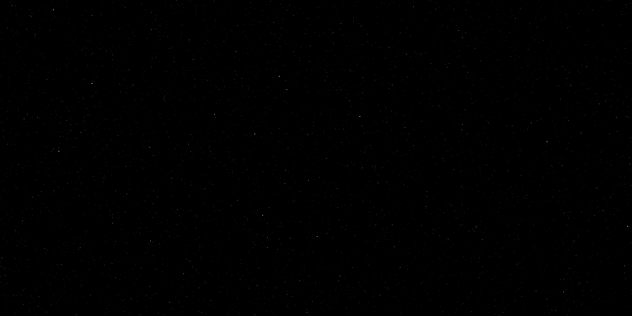
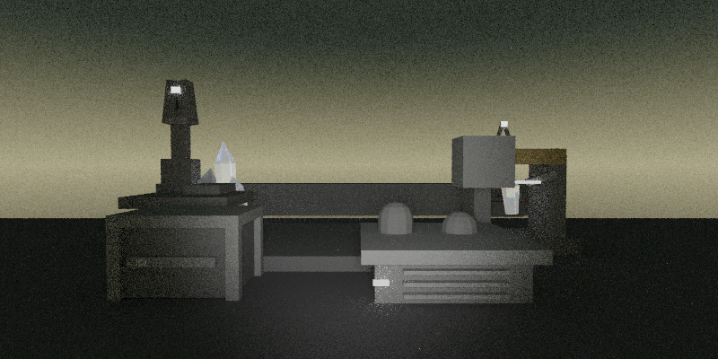
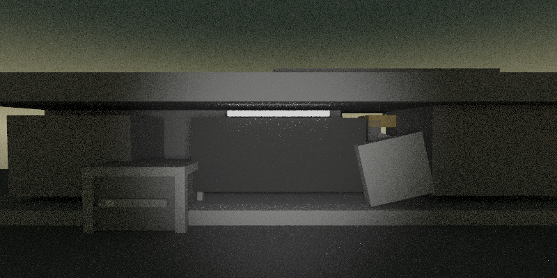
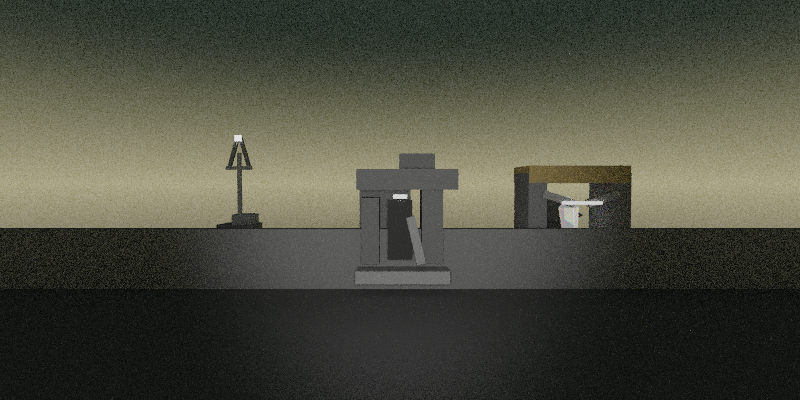
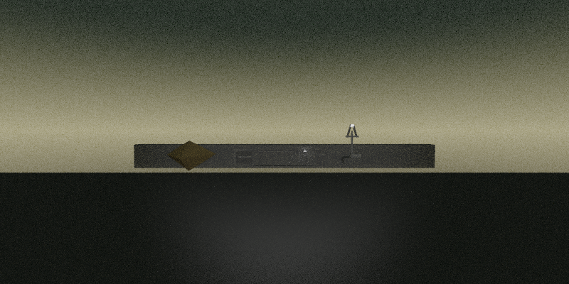

# Scene Generation Benchmark

Genere le 2026-10-24 14:32:07.

Generation directe de `.scene` ; profil `ministral-8b-reasoning-q4`, modele `Ministral-3-8B-Reasoning-2512-Q4_K_M.gguf`.

Pipeline :
- le moteur fabrique le prompt exact via `--dump-scene-audit-prompt`
- `llama-cli` genere une reponse brute
- la reponse est normalisee en `.scene`
- le renderer audite le fichier et produit une image si la scene est valide

Parametres :
- rendu : `800x400`, `8` spp, `3` bounces, `1` direct samples
- LLM : `temperature=0.7`, `n_predict=1024`, `ctx=4096`, `seed=44`
- reflexion : `on`, budget `512` ; top_k `40`, top_p `0.95`
- seul le canal final termine par EOS est audite ; les sorties tronquees sont refusees

Resultat global : `10/10` scenes avec syntaxe et camera valides, `0` invalides. Syntaxe seule : `10/10`.

| Case | Status | Gen ms | Audit ms | Triangles | Materials |
| --- | --- | ---: | ---: | ---: | ---: |
| `entry_gate_dusk` | `valid` | 18524.13 | 1031.55 | 554 | 46 |
| `sally_port_checkpoint` | `valid` | 19643.90 | 738.88 | 806 | 37 |
| `badge_vestibule` | `valid` | 22030.19 | 793.81 | 754 | 58 |
| `server_aisles_dense` | `valid` | 25455.68 | 1738.30 | 1078 | 55 |
| `control_hub` | `valid` | 17269.63 | 374.57 | 704 | 29 |
| `backup_vault` | `valid` | 24261.15 | 2683.90 | 972 | 53 |
| `cooling_exchange_bay` | `valid` | 22653.78 | 1003.97 | 1130 | 59 |
| `loading_dock_dust` | `valid` | 20975.61 | 1493.73 | 850 | 50 |
| `roof_watch_dusk` | `valid` | 17098.80 | 646.00 | 322 | 27 |
| `stairhead_parapet` | `valid` | 18347.88 | 512.55 | 442 | 38 |

## Entry Gate

A concrete gate court faces the datacenter threshold. Dust clings to the bars and the badge reader blinks beside a service intercom.

Status : `valid`
Slug : `entry_gate_dusk`
Generation : `18524.13 ms`
Audit + render : `1031.55 ms`
Scene lines : `11`
Scene chars : `915`
Triangles : `554`
Materials : `46`

State : `states/entry_gate_dusk.session.json`
Prompt : `prompts/entry_gate_dusk.prompt.txt`
Raw response : `responses/entry_gate_dusk.raw.txt`
Final response : `responses/entry_gate_dusk.final.txt`
Stop reason : `eos`
Scene : `scenes/entry_gate_dusk.scene`
Audit stdout : `logs/entry_gate_dusk.audit.stdout.txt`
Audit stderr : `logs/entry_gate_dusk.audit.stderr.txt`

Spatial brief :
- location_id: `gate`
- location_archetype: `threshold courtyard`
- time_of_day: `dusk`
- visibility_level: `clear`
- desert_state: `still`
- interior_density: `sparse`
- alert_level: `1`
- anchors: `gate frame, perimeter wall, badge reader, intercom plate`
- visible_objects: `badge reader, service intercom, warning placard, padlocked crate`
- blocked_exits: `west, south`
- spatial_anomalies: `(none)`

## Sally Port Checkpoint

A narrow checkpoint sits between two heavy gates. A code keypad, a dead camera head, and a steel cabinet make the space feel procedural and exposed.

Status : `valid`
Slug : `sally_port_checkpoint`
Generation : `19643.90 ms`
Audit + render : `738.88 ms`
Scene lines : `12`
Scene chars : `998`
Triangles : `806`
Materials : `37`

State : `states/sally_port_checkpoint.session.json`
Prompt : `prompts/sally_port_checkpoint.prompt.txt`
Raw response : `responses/sally_port_checkpoint.raw.txt`
Final response : `responses/sally_port_checkpoint.final.txt`
Stop reason : `eos`
Scene : `scenes/sally_port_checkpoint.scene`
Audit stdout : `logs/sally_port_checkpoint.audit.stdout.txt`
Audit stderr : `logs/sally_port_checkpoint.audit.stderr.txt`

Spatial brief :
- location_id: `unknown`
- location_archetype: `security checkpoint`
- time_of_day: `night`
- visibility_level: `low`
- desert_state: `windy`
- interior_density: `sparse`
- alert_level: `2`
- anchors: `inner gate, outer gate, checkpoint alcove`
- visible_objects: `code keypad, steel cabinet, dead camera head, inspection hatch`
- blocked_exits: `south`
- spatial_anomalies: `camera loop stuck on static`

## Badge Vestibule

A bare vestibule buffers the exterior from the datacenter core. The only relief is a reader column, a maintenance hatch, and a wall placard with faded rules.

Status : `valid`
Slug : `badge_vestibule`
Generation : `22030.19 ms`
Audit + render : `793.81 ms`
Scene lines : `14`
Scene chars : `1135`
Triangles : `754`
Materials : `58`

State : `states/badge_vestibule.session.json`
Prompt : `prompts/badge_vestibule.prompt.txt`
Raw response : `responses/badge_vestibule.raw.txt`
Final response : `responses/badge_vestibule.final.txt`
Stop reason : `eos`
Scene : `scenes/badge_vestibule.scene`
Audit stdout : `logs/badge_vestibule.audit.stdout.txt`
Audit stderr : `logs/badge_vestibule.audit.stderr.txt`

Spatial brief :
- location_id: `unknown`
- location_archetype: `airlock vestibule`
- time_of_day: `night`
- visibility_level: `clear`
- desert_state: `still`
- interior_density: `sparse`
- alert_level: `1`
- anchors: `reader column, inner door, outer door`
- visible_objects: `badge reader, maintenance hatch, wall placard, ceiling speaker`
- blocked_exits: `west`
- spatial_anomalies: `(none)`

## Primary Server Aisles

Dense aisles of racks run into darkness. A service cart, a floor hatch, and a side console break the repetition under red LEDs.

Status : `valid`
Slug : `server_aisles_dense`
Generation : `25455.68 ms`
Audit + render : `1738.30 ms`
Scene lines : `17`
Scene chars : `1395`
Triangles : `1078`
Materials : `55`

State : `states/server_aisles_dense.session.json`
Prompt : `prompts/server_aisles_dense.prompt.txt`
Raw response : `responses/server_aisles_dense.raw.txt`
Final response : `responses/server_aisles_dense.final.txt`
Stop reason : `eos`
Scene : `scenes/server_aisles_dense.scene`
Audit stdout : `logs/server_aisles_dense.audit.stdout.txt`
Audit stderr : `logs/server_aisles_dense.audit.stderr.txt`

Spatial brief :
- location_id: `server_aisles`
- location_archetype: `server aisles`
- time_of_day: `night`
- visibility_level: `low`
- desert_state: `still`
- interior_density: `dense`
- alert_level: `2`
- anchors: `rack corridor, service lane, ceiling cable tray`
- visible_objects: `service cart, floor hatch, side console, sealed lockbox`
- blocked_exits: `south`
- spatial_anomalies: `cooling hum pulses unevenly`

## Sector Control Hub

A compact control room opens off the aisles. One main console dominates the center while a locked cabinet and an access hatch wait at the margins.

Status : `valid`
Slug : `control_hub`
Generation : `17269.63 ms`
Audit + render : `374.57 ms`
Scene lines : `10`
Scene chars : `810`
Triangles : `704`
Materials : `29`

State : `states/control_hub.session.json`
Prompt : `prompts/control_hub.prompt.txt`
Raw response : `responses/control_hub.raw.txt`
Final response : `responses/control_hub.final.txt`
Stop reason : `eos`
Scene : `scenes/control_hub.scene`
Audit stdout : `logs/control_hub.audit.stdout.txt`
Audit stderr : `logs/control_hub.audit.stderr.txt`

Spatial brief :
- location_id: `unknown`
- location_archetype: `control room`
- time_of_day: `night`
- visibility_level: `clear`
- desert_state: `still`
- interior_density: `sparse`
- alert_level: `2`
- anchors: `main console, wall cabinet, floor hatch`
- visible_objects: `main console, locked cabinet, floor hatch, status placard`
- blocked_exits: `east, south`
- spatial_anomalies: `(none)`

## Backup Vault

A chilled storage vault holds sealed pods and backup racks. A biometric pad, a wheeled crate, and a suspended service panel suggest expensive access.

Status : `valid`
Slug : `backup_vault`
Generation : `24261.15 ms`
Audit + render : `2683.90 ms`
Scene lines : `16`
Scene chars : `1302`
Triangles : `972`
Materials : `53`

State : `states/backup_vault.session.json`
Prompt : `prompts/backup_vault.prompt.txt`
Raw response : `responses/backup_vault.raw.txt`
Final response : `responses/backup_vault.final.txt`
Stop reason : `eos`
Scene : `scenes/backup_vault.scene`
Audit stdout : `logs/backup_vault.audit.stdout.txt`
Audit stderr : `logs/backup_vault.audit.stderr.txt`

Spatial brief :
- location_id: `unknown`
- location_archetype: `backup vault`
- time_of_day: `night`
- visibility_level: `low`
- desert_state: `still`
- interior_density: `dense`
- alert_level: `3`
- anchors: `sealed data pods, vault door, service panel`
- visible_objects: `biometric pad, wheeled crate, service panel, emergency switch`
- blocked_exits: `north, west`
- spatial_anomalies: `cold vapor drifts near the floor`

## Cooling Exchange Bay

Tall cooling blocks and pipe runs crowd an industrial chamber. A valve wheel, a drip tray, and a maintenance console provide the room's few obvious handles.

Status : `valid`
Slug : `cooling_exchange_bay`
Generation : `22653.78 ms`
Audit + render : `1003.97 ms`
Scene lines : `15`
Scene chars : `1245`
Triangles : `1130`
Materials : `59`

State : `states/cooling_exchange_bay.session.json`
Prompt : `prompts/cooling_exchange_bay.prompt.txt`
Raw response : `responses/cooling_exchange_bay.raw.txt`
Final response : `responses/cooling_exchange_bay.final.txt`
Stop reason : `eos`
Scene : `scenes/cooling_exchange_bay.scene`
Audit stdout : `logs/cooling_exchange_bay.audit.stdout.txt`
Audit stderr : `logs/cooling_exchange_bay.audit.stderr.txt`

Spatial brief :
- location_id: `unknown`
- location_archetype: `cooling plant bay`
- time_of_day: `night`
- visibility_level: `dusty`
- desert_state: `still`
- interior_density: `dense`
- alert_level: `2`
- anchors: `cooling blocks, pipe gallery, drain trench`
- visible_objects: `valve wheel, maintenance console, drip tray, tool locker`
- blocked_exits: `west`
- spatial_anomalies: `one pipe bank rattles under strain`

## Dust Loading Dock

A side loading bay opens toward the desert through a half-raised shutter. Pallets, a cargo crate, and a bent lamp post stage a tense threshold between inside and outside.

Status : `valid`
Slug : `loading_dock_dust`
Generation : `20975.61 ms`
Audit + render : `1493.73 ms`
Scene lines : `13`
Scene chars : `1105`
Triangles : `850`
Materials : `50`

State : `states/loading_dock_dust.session.json`
Prompt : `prompts/loading_dock_dust.prompt.txt`
Raw response : `responses/loading_dock_dust.raw.txt`
Final response : `responses/loading_dock_dust.final.txt`
Stop reason : `eos`
Scene : `scenes/loading_dock_dust.scene`
Audit stdout : `logs/loading_dock_dust.audit.stdout.txt`
Audit stderr : `logs/loading_dock_dust.audit.stderr.txt`

Spatial brief :
- location_id: `unknown`
- location_archetype: `loading dock`
- time_of_day: `dusk`
- visibility_level: `dusty`
- desert_state: `dusty`
- interior_density: `sparse`
- alert_level: `2`
- anchors: `half-raised shutter, dock lip, desert threshold`
- visible_objects: `cargo crate, shipping placard, control switch, lamp post`
- blocked_exits: `north`
- spatial_anomalies: `dust slips under the shutter in thin sheets`

## Roof Watch

The datacenter roof becomes a parapet walk above the desert. A beacon mast, a hatch door, and a field scope hold the line against the horizon.

Status : `valid`
Slug : `roof_watch_dusk`
Generation : `17098.80 ms`
Audit + render : `646.00 ms`
Scene lines : `10`
Scene chars : `822`
Triangles : `322`
Materials : `27`

State : `states/roof_watch_dusk.session.json`
Prompt : `prompts/roof_watch_dusk.prompt.txt`
Raw response : `responses/roof_watch_dusk.raw.txt`
Final response : `responses/roof_watch_dusk.final.txt`
Stop reason : `eos`
Scene : `scenes/roof_watch_dusk.scene`
Audit stdout : `logs/roof_watch_dusk.audit.stdout.txt`
Audit stderr : `logs/roof_watch_dusk.audit.stderr.txt`

Spatial brief :
- location_id: `roof_watch`
- location_archetype: `roof parapet`
- time_of_day: `dusk`
- visibility_level: `clear`
- desert_state: `windy`
- interior_density: `sparse`
- alert_level: `1`
- anchors: `parapet, horizon, beacon mast, roof hatch`
- visible_objects: `roof hatch, field scope, beacon mast switch, warning sign`
- blocked_exits: `south`
- spatial_anomalies: `(none)`

## Parapet Stairhead

A concrete stairhead interrupts the roof line. The landing is tight, with a latch box, a cable spool, and a narrow gate looking over the darkening desert.

Status : `valid`
Slug : `stairhead_parapet`
Generation : `18347.88 ms`
Audit + render : `512.55 ms`
Scene lines : `11`
Scene chars : `897`
Triangles : `442`
Materials : `38`

State : `states/stairhead_parapet.session.json`
Prompt : `prompts/stairhead_parapet.prompt.txt`
Raw response : `responses/stairhead_parapet.raw.txt`
Final response : `responses/stairhead_parapet.final.txt`
Stop reason : `eos`
Scene : `scenes/stairhead_parapet.scene`
Audit stdout : `logs/stairhead_parapet.audit.stdout.txt`
Audit stderr : `logs/stairhead_parapet.audit.stderr.txt`

Spatial brief :
- location_id: `unknown`
- location_archetype: `roof stairhead`
- time_of_day: `dusk`
- visibility_level: `low`
- desert_state: `windy`
- interior_density: `sparse`
- alert_level: `1`
- anchors: `stairhead bulk, roof gate, parapet edge`
- visible_objects: `latch box, cable spool, roof gate handle, inspection placard`
- blocked_exits: `east, south`
- spatial_anomalies: `wind makes the gate vibrate softly`

