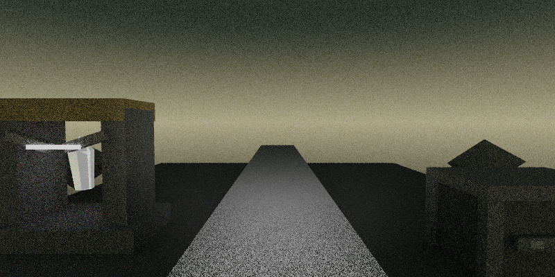
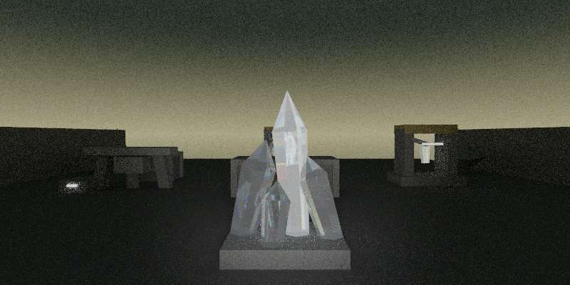

# Scene Generation Benchmark

Genere le 2026-10-24 09:25:19.

Generation directe de `.scene` ; profil `gemma-e4b`, modele `gemma-4-E4B-it-Q4_K_M.gguf`.

Pipeline :
- le moteur fabrique le prompt exact via `--dump-scene-audit-prompt`
- `llama-cli` genere une reponse brute
- la reponse est normalisee en `.scene`
- le renderer audite le fichier et produit une image si la scene est valide

Parametres :
- rendu : `800x400`, `8` spp, `3` bounces, `1` direct samples
- LLM : `temperature=0.0`, `n_predict=1024`, `ctx=4096`, `seed=42`
- reflexion : `off`, budget `0` ; top_k `40`, top_p `0.95`
- seul le canal final termine par EOS est audite ; les sorties tronquees sont refusees

Resultat global : `3/3` scenes avec syntaxe et camera valides, `0` invalides. Syntaxe seule : `3/3`.

| Case | Status | Gen ms | Audit ms | Triangles | Materials |
| --- | --- | ---: | ---: | ---: | ---: |
| `entry_gate_dusk` | `valid` | 14233.37 | 526.86 | 618 | 36 |
| `server_aisles_dense` | `valid` | 20420.36 | 826.76 | 1114 | 67 |
| `backup_vault` | `valid` | 16474.26 | 1084.25 | 954 | 45 |

## Entry Gate

A concrete gate court faces the datacenter threshold. Dust clings to the bars and the badge reader blinks beside a service intercom.

Status : `valid`
Slug : `entry_gate_dusk`
Generation : `14233.37 ms`
Audit + render : `526.86 ms`
Scene lines : `12`
Scene chars : `1016`
Triangles : `618`
Materials : `36`

State : `states/entry_gate_dusk.session.json`
Prompt : `prompts/entry_gate_dusk.prompt.txt`
Raw response : `responses/entry_gate_dusk.raw.txt`
Final response : `responses/entry_gate_dusk.final.txt`
Stop reason : `eos`
Scene : `scenes/entry_gate_dusk.scene`
Audit stdout : `logs/entry_gate_dusk.audit.stdout.txt`
Audit stderr : `logs/entry_gate_dusk.audit.stderr.txt`

Spatial brief :
- location_id: `gate`
- location_archetype: `threshold courtyard`
- time_of_day: `dusk`
- visibility_level: `clear`
- desert_state: `still`
- interior_density: `sparse`
- alert_level: `1`
- anchors: `gate frame, perimeter wall, badge reader, intercom plate`
- visible_objects: `badge reader, service intercom, warning placard, padlocked crate`
- blocked_exits: `west, south`
- spatial_anomalies: `(none)`

## Primary Server Aisles

Dense aisles of racks run into darkness. A service cart, a floor hatch, and a side console break the repetition under red LEDs.

Status : `valid`
Slug : `server_aisles_dense`
Generation : `20420.36 ms`
Audit + render : `826.76 ms`
Scene lines : `19`
Scene chars : `1675`
Triangles : `1114`
Materials : `67`

State : `states/server_aisles_dense.session.json`
Prompt : `prompts/server_aisles_dense.prompt.txt`
Raw response : `responses/server_aisles_dense.raw.txt`
Final response : `responses/server_aisles_dense.final.txt`
Stop reason : `eos`
Scene : `scenes/server_aisles_dense.scene`
Audit stdout : `logs/server_aisles_dense.audit.stdout.txt`
Audit stderr : `logs/server_aisles_dense.audit.stderr.txt`

Spatial brief :
- location_id: `server_aisles`
- location_archetype: `server aisles`
- time_of_day: `night`
- visibility_level: `low`
- desert_state: `still`
- interior_density: `dense`
- alert_level: `2`
- anchors: `rack corridor, service lane, ceiling cable tray`
- visible_objects: `service cart, floor hatch, side console, sealed lockbox`
- blocked_exits: `south`
- spatial_anomalies: `cooling hum pulses unevenly`

## Backup Vault

A chilled storage vault holds sealed pods and backup racks. A biometric pad, a wheeled crate, and a suspended service panel suggest expensive access.

Status : `valid`
Slug : `backup_vault`
Generation : `16474.26 ms`
Audit + render : `1084.25 ms`
Scene lines : `15`
Scene chars : `1224`
Triangles : `954`
Materials : `45`

State : `states/backup_vault.session.json`
Prompt : `prompts/backup_vault.prompt.txt`
Raw response : `responses/backup_vault.raw.txt`
Final response : `responses/backup_vault.final.txt`
Stop reason : `eos`
Scene : `scenes/backup_vault.scene`
Audit stdout : `logs/backup_vault.audit.stdout.txt`
Audit stderr : `logs/backup_vault.audit.stderr.txt`

Spatial brief :
- location_id: `unknown`
- location_archetype: `backup vault`
- time_of_day: `night`
- visibility_level: `low`
- desert_state: `still`
- interior_density: `dense`
- alert_level: `3`
- anchors: `sealed data pods, vault door, service panel`
- visible_objects: `biometric pad, wheeled crate, service panel, emergency switch`
- blocked_exits: `north, west`
- spatial_anomalies: `cold vapor drifts near the floor`

